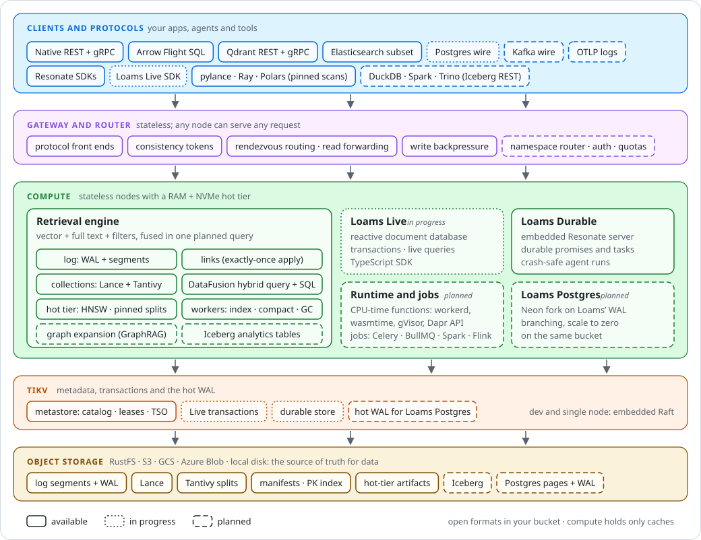

# Loams

[](https://discord.gg/eK6NanHQq)

**Don't rent a cloud. Loam it.**

Build software with agents, on ground you own. Free and open source. Runs on ground you own.

"Loams" is the product, like soil. "Loam" is the verb: you loam a backend, and a deployment is a plot. Compute runs in your account, and data sits in your bucket (S3, GCS, Azure, RustFS or a local folder) in open formats. The soil names below sit next to the technical names; the docs and the APIs keep using the technical ones.

Loams is open-source tooling for building software with AI agents: **Loams Studio (The Field)** runs your coding agents side by side, each in its own plot, **Loams Software Factory (The Greenhouse)** keeps your development toolchain beside them, and the **Loams Marketplace (The Seed Exchange, coming soon)** is where agents, apps and harnesses will come from. All three sit on the Loams data platform, written in Rust, which keeps your data in *your* object-storage bucket (S3, GCS, Azure Blob, RustFS or a local directory) in open formats.

> **0.1.4 — a patch release of 0.1, the first release.** You run the stack yourself with Docker Compose, locally or on your own VMs, over your own Tailscale tailnet; the engine serves the console at `/ui/`, and Loams Desktop opens in Studio. 0.x: APIs and on-disk formats may change between minor versions; upgrades are supported with `loams upgrade`.

[Products](https://loams.dev/products) · [Download Loams Desktop](https://github.com/ostrium-labs/loams/releases/latest) · [Run Loams](docs/release/preview.md) · [Documentation](docs/README.md) · [Website](https://loams.dev) · [API reference](https://loams.dev/api-docs) · [Contributing](CONTRIBUTING.md)

## Products

| Product | What it does | Status |
|---|---|---|
| **[Loams Studio](https://loams.dev/products/studio)**<br>*The Field* | An agentic development environment. Runs the coding-agent CLIs you already use (Claude Code, Codex, opencode, Pi and ACP agents) in threads, each agent in its own plot (a git worktree), with diff review and comments, per-turn checkpoints, supervised approvals, terminals, previews, git actions, and run groups that send one prompt to several agents so you can compare and merge the best result. Everything goes through `loams-agentd`, the per-user agent daemon. | **Experimental, since 0.1.0.** Loams Desktop for Linux, macOS and Windows, with the daemon bundled; or the browser console against a remote `loams-agentd` over TLS and OIDC. New threads are supervised by default. [Guides](docs/guides/studio/index.md) |
| **[Loams Software Factory](https://loams.dev/products/software-factory)**<br>*The Greenhouse* | Your development toolchain next to your agents: Forgejo, Zulip, Plane (through ItsAPlan), GlitchTip, OpenPanel, Matomo, Langfuse and SigNoz (Preview: SigNoz on Loams House), which you run, shown as read-only panels and their own full UIs under Studio. A Plane issue or a GlitchTip error becomes a Studio thread; a thread's branch becomes a Forgejo pull request. | **Experimental, since 0.1.0, desktop only.** The factory in the browser console is in review ([#844](https://github.com/ostrium-labs/loams/pull/844)). The agent loop that takes an issue to a reviewed change ([§39](docs/design/39-software-factory-and-loams-bot.md)) is being redesigned: its first plans, SF2 to SF5, were retired on 2026-10-19. [Guide](docs/guides/studio/factory.md) |
| **[Loams Marketplace](https://loams.dev/products/marketplace)**<br>*The Seed Exchange* | Agents, harnesses, console plugins and factory apps you install into your own Loams, with their permissions and licences shown before anything is created. It builds on the console plugin host and the `loams-agentd` harness catalogue, which ship today. | **Coming soon.** No listings and no install flow yet; a draft [publishing guide](docs/marketplace/publishing.md) exists. |

## Who it's for

Our primary audience is **service-as-software companies**: companies whose product is AI agents doing service work, and whose margins depend on what each agent run costs in compute, storage and data. If you sell service as software, the cloud bill is your cost of goods, and renting it from a landlord who sets the price eats your margin. Loams runs your agents and their data on ground you own: compute in your account, data in your bucket, in open formats, so the cost of each run is yours to control. It also suits any team building with coding agents. Don't rent a cloud. Loam it.

## The data platform

Underneath the products is the data platform. A typical AI application runs Elasticsearch, Qdrant, a graph database, Kafka and a workflow engine: five stateful clusters, several copies of the same data, and retrieval glued together in application code. Loams replaces them with one engine on one bucket:

- **Your bucket is the source of truth.** Object-storage prices, no 3× block-storage replication; losing a node loses no data.
- **The log is the spine.** Every write lands in a log; collections are materializations of it, and every write returns a consistency token later reads can wait on.
- **Hybrid retrieval in one plan.** Vectors, BM25 and filters fused with RRF in one DataFusion query, with hot tiers in RAM and NVMe.
- **Drop-in APIs.** Existing Qdrant and Elasticsearch clients (and LangChain and LlamaIndex on top of them) work unmodified, plus Arrow Flight SQL.
- **More than retrieval.** Reactive documents (Live), graphs (Graph), analytics (House), MySQL and Postgres, and durable agent runs (Durable), on the same storage.

Read the [pitch](docs/design/00-pitch.md) and the [architecture](docs/design/01-architecture.md).

<p align="center">
  
</p>

## What ships in 0.1.4

| | |
|---|---|
| **Retrieval engine** | Collections, hybrid search, SQL, streams and links; native REST, Arrow Flight SQL, Qdrant and Elasticsearch APIs; Postgres and MySQL wire |
| **Loams Live** | A reactive document database: transactions, indexes and live queries |
| **Loams Graph** | GQL graphs, with writes on the Loams log and crash recovery. Experimental: graph expansion for GraphRAG (1 to 2 hops from search hits, and SQL `graph_*` functions) |
| **Loams House** | Experimental. ClickHouse-compatible analytics with engine-level access control (opt-in profile) |
| **Loams SQL / Postgres** | MySQL on a patched TiDB; Postgres on our Neon fork, storage on the bucket |
| **Loams Durable** | Durable promises and tasks for agent runs (an embedded Resonate server) |
| **Console, desktop, CLI** | Web console served by your engine at `/ui/`; Loams Desktop and the `loams` CLI for Linux, macOS and Windows |
| **Loams Studio and Software Factory** | Experimental. See [Products](#products) above |
| **Loams Git** | Experimental. `git-remote-loams`, git's remote helper, ships with the `loams` CLI packages: `git clone`, `fetch` and `push` reach a Loams Git repository on a bucket, with no server in between |
| **Preview in 0.1.4** | Cost attribution (design 84) and the offline `loams cost` CLI; resumable transfers and job runs over QUIC in Loams Desktop (design 85). Opt-in profiles, off by default: managed RisingWave, Flink SQL and Spark behind `loams-gateway` (design 81); the Temporal gateway (`temporal-gateway`) with SDK legs for eight languages; Airflow and DBOS on Loams Postgres; Loams Meter (metering, entitlements, billing export); the Redis-protocol gateway on Loams KV; Confluent Cloud connectors for BYOC; OpenFGA authorization (`authz`); a headless browser for agents (`browser`) |
| **SDKs** | TypeScript, Python, Go, Rust, C#, C++ and Swift, each with the app-building API (collections, search, vector, graph, SQL and streams). Published to npm, PyPI, crates.io, NuGet and the Go proxy as `0.1.4`; Swift from the release tag, C++ as a release tarball. Experimental: Java and Kotlin on Maven Central, Ruby on RubyGems |

**Coming next:** Loams Git on the server (repositories in the release images), first-party connectors, Iceberg analytics, the Kafka wire into the engine (a preview `kafka` profile ships since 0.1.2), functions and jobs. The full status table is in [Running Loams](docs/release/preview.md); the plan is in the [roadmap](docs/design/12-roadmap-testing-risks.md).

## Quick start

Run the whole stack (needs Docker Compose and a [Tailscale](https://tailscale.com) auth key):

```sh
git clone https://github.com/ostrium-labs/loams.git
cd loams/deploy/release
cp .env.example .env        # set TS_AUTHKEY
docker compose up -d
```

Then reach your plot at `https://loams.<your-tailnet>.ts.net` from a device on the same tailnet. Details, BYOG (bring your own ground, formerly BYOC) over SSH and auth modes: [Running Loams](docs/release/preview.md).

Or build just the engine and run it on one machine:

```sh
cargo run --release -p loams -- dev    # native API on 127.0.0.1:8080, Qdrant on :6333, Elasticsearch on :9200
```

Examples for the native API, Qdrant clients, Flight SQL and reading the bucket directly are in the [engine quick start](docs/engine-quickstart.md).

## Repository

The engine crates, the web console, Loams Desktop, the mobile apps, SDKs, protos, connectors and deploy files all live here; see the [project layout](docs/project-layout.md) and the [monorepo guide](docs/monorepo.md). Design documents are in [`docs/design`](docs/design/README.md) and task-by-task plans in [`docs/plans`](docs/plans/README.md). The metering agent and the hosted-cloud platform docs (metering, billing, identity and tailnet deploys), merged from the former private platform repository, are in [`crates/loams-meter-agent`](crates/loams-meter-agent) and [`docs/platform`](docs/platform/README.md).

## Contributing and community

Bug reports, client compatibility reports, docs fixes, tests and code are all welcome. Start with [CONTRIBUTING.md](CONTRIBUTING.md) and issues labelled [`good first issue`](https://github.com/ostrium-labs/loams/issues?q=is%3Aissue+is%3Aopen+label%3A%22good+first+issue%22); open an issue before changing a format, protocol or design decision.

Questions and chat are welcome on [Discord](https://discord.gg/eK6NanHQq); bugs and feature requests belong in GitHub issues.

[Discord](https://discord.gg/eK6NanHQq) · [Discussions](https://github.com/ostrium-labs/loams/discussions) · [Issues](https://github.com/ostrium-labs/loams/issues) · [Security](SECURITY.md) · [Code of Conduct](CODE_OF_CONDUCT.md) · [Governance](GOVERNANCE.md) · [Ecosystem](ECOSYSTEM.md) · [Privacy](PRIVACY.md)

## Code signing policy

- **Linux and checksums:** the release workflows sign `.deb`, `.pacman`, AppImage and `SHA256SUMS` with the [project GPG key](docs/release/loams-release-key.asc), set up on 2026-10-16 and rotated on 2026-10-26 ([transition statement](docs/release/key-transition-2026-10.md)); `.rpm` packages are planned for SignPath. The previews so far shipped without it: a file built without its signing credentials is named `-unsigned`, as every v0.1.0-preview.2 desktop file is, and the release notes say so.
- **Windows and macOS:** unsigned today. The Windows (Authenticode) and `.rpm` signing steps through [SignPath Foundation](https://signpath.org) are built into the release workflows, but the application is not made yet, so nothing is signed that way; it will be made once the project has traction. macOS stays unsigned and not notarized.
- **Verify a download:** `sha256sum -c SHA256SUMS --ignore-missing`, then `gpg --import docs/release/loams-release-key.asc` (it holds both keys: the current one, fingerprint `29C5 CC3F 0FD6 6A2A D32E CB30 9E8E C3E0 AAB5 BA68`, signs releases after 0.1.2; the previous one, `333A C945 99D5 A1EB 2A41 6D1E 83DC 134D 8CAF 895D`, signed 0.1.0 to 0.1.2 and is not revoked) and `gpg --verify SHA256SUMS.asc SHA256SUMS`.
- **Roles:** the three SignPath roles (authors, reviewers, approvers) are the repository's maintainers and owners; the named people will be listed here once the application is approved. Details: [signing policy](docs/release/signing.md), [desktop releases](docs/release/desktop.md).

## License

[Apache License 2.0](LICENSE). Loams builds on DataFusion, Lance, Tantivy, Quickwit, qdrant-edge, SlateDB, openraft, TiKV, TiDB, Neon, Grafeo, chDB and Resonate; attributions are in [NOTICE](NOTICE). Loams is free and open source: there is no open core and no paid edition. The metering, billing and control-plane code is moving into the open repo now (D1119). Loams is built by [Ostrium Labs](https://ostriumlabs.org), a research lab building open-source Loams.
