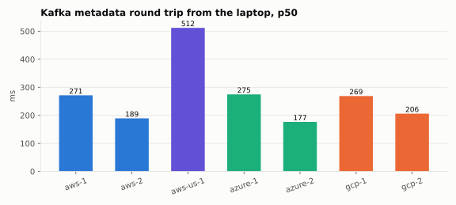
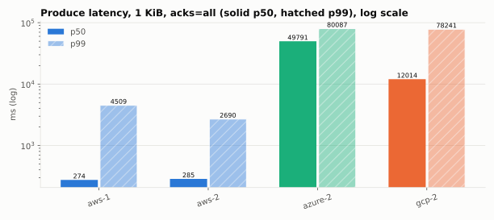
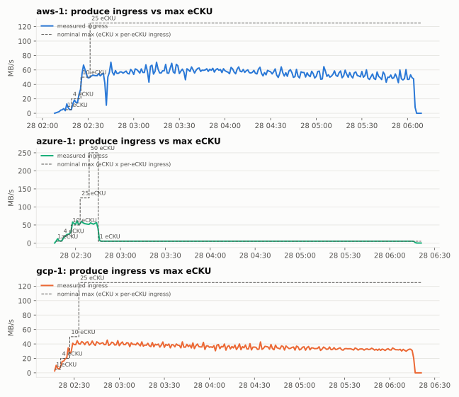
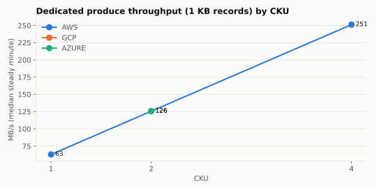
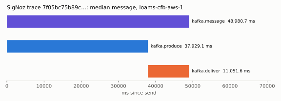
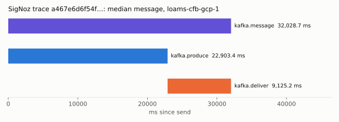
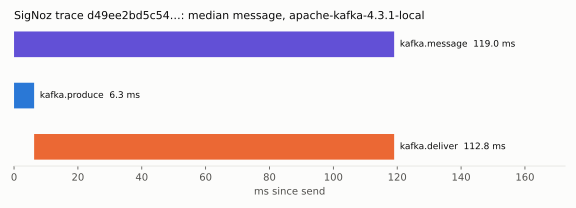
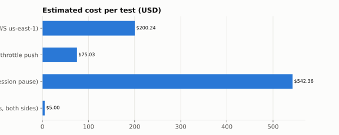

# Confluent Cloud on AWS, Google Cloud and Azure: benchmark, 2026-10-28

Lane CFB, for the owner's request of 2026-10-28: "in confluent set 400 dollar limit and use it now fully, run multi cluster and back traces using signoz, push to max, use it to test aws, azure and gcp also and publish the benchmarks". The budget was raised to $2,000 the same day.

Summary issue: #1509. The harness, raw results and ledger are in [`bench/confluent/`](../../bench/confluent/). The numbers are in [`results/2026-10-28/`](../../bench/confluent/results/2026-10-28/). Every number below is **measured** unless it is labelled **projected**.

## Summary

- **Dedicated throttles produce at 62.8 MB/s (about 60 MiB/s) per CKU, the same on AWS, GCP and Azure, and it scales linearly.** In-region Flink load measured these steady 1 KB ingress rates, after a burst of up to 341 MB/s on 4 CKU:

  | Cluster | Cloud | CKU | Steady ingress |
  | --- | --- | --- | --- |
  | aws-d1 | AWS | 1 | 62.8 MB/s |
  | gcp-d2 | GCP | 2 | 125.6 MB/s |
  | azure-d2 | Azure | 2 | 125.6 MB/s |
  | aws-d4 | AWS | 4 | 251.1 MB/s |

  Scaling efficiency from 1 to 4 CKU is 100% (measured).
- **100 B records:** 1.27M records/s on 4 CKU (317k per CKU) and 421k/s on 2 CKU (211k per CKU). That is 32 MB/s per CKU or less, under the byte throttle, so these record rates are a lower bound set by the generator.
- **1 billion records/s (PROJECTED):** between about 1,600 CKU (if the byte throttle is the only limit) and about 3,160 CKU (at the measured record rate). At an assumed $4/CKU-hour, that is $6.4k–12.6k per hour before data charges.
- **Basic honours max eCKU with a burst allowance.**
  - At 1 eCKU (nominal 5 MB/s), the first minutes reach 11–13 MB/s, then ingress settles at 5–10 MB/s.
  - At 4 eCKU, ingress held 15–23 MB/s against a nominal 20.
  - At 10 eCKU and above, 7 Flink statements topped out at 39–56 MB/s, which is the generator's limit, not the cluster's.
  - The cap is the throttle design 80 relies on (D1825). Confirmed.
- **Exactly-once works on Confluent Standard on all three clouds:** 480 committed, 120 aborted, and read_committed saw 0 aborted, 0 missing and 0 duplicates. Commit p50 is 470–610 ms from India.
  - **Iggy gateway (local, `loams` 03cd4aac): FAILS read_committed.** The consumer saw all 120 aborted records, because KW-T step 2 (read_committed/LSO) is not merged.
  - **Apache Kafka 4.3.1 (local, one node):** refused transactional produce with NOT_ENOUGH_REPLICAS even though min ISR is 1. This is unresolved.
- **The laptop link is the bottleneck for every client-side number.**
  - Metadata round trip p50 is 180–510 ms (us-east-1 the slowest), with p99 of 1–3 s.
  - WAN produce throughput is about 0.6 MB/s per cluster, or 1.9 MB/s across three clusters in parallel.
  - Same-cloud VMs are needed for real client latency; they are pending until the cloud credentials are fixed.
- **Loams connect role:** this run found and fixed a data-loss bug, PR #1496. A connect restart with a backlog sent every event to the DLQ: 9,368 of 10,000 records were missing after a kill -9. It also found an engine idempotency bug that duplicates the in-flight batch after a kill (323 of 10,000).
- **Spend:** an upper-bound estimate of **$822.64–$886.54** of the $2,000 limit. The higher figure is the guard's binding number. The Costs API confirmation is pending (72 h lag). About $150–250 of that was Dedicated capacity sitting idle while the session was paused; see Spend.

## Where the load came from, and what that means for the numbers

| Load source | What it can measure | What it cannot |
| --- | --- | --- |
| **This laptop (India), over the internet.** librdkafka 2.16.0 driver, `bench/confluent/driver.py`. | Latency as seen from a client in India, correctness (EOS), Cluster Linking end to end, the Loams connect role. | Throughput. The laptop shares a carrier hotspot uplink with a second laptop: about 0.2–2 MB/s up, with stalls of several seconds. **Latency tails measure that link, not Confluent.** |
| **Confluent Cloud for Apache Flink in the same region as the cluster.** `faker` ids fanned out with UNNEST into raw records (`flink-setup.sh`, `dedicated.sh`). | Ingress and egress up to the cluster's throttle, records/s, requests/s (Confluent Metrics API, per minute). | Client-side latency. The generator's own ceiling: about 10 MB/s per Flink statement, so a cluster is only shown at its limit when the curve goes flat below the generator's capacity. |
| **Local baselines (this laptop, loopback):** Apache Kafka 4.3.1 (container, one KRaft node) and the Loams Iggy Kafka gateway (release build of `ostrium-labs/iggy@loams` 03cd4aac, 4 shards). | The same driver and scenarios as the cloud runs, for comparison. | Anything about the cloud. The Python driver limits local throughput (labelled). **Local, not cloud.** |

**Same-cloud drivers are still pending.** The owner's AWS, Azure and Google Cloud accounts can't run VMs yet: an AWS SCP denies EC2, the Azure app id is wrong, and the GCP key is empty (`cb1-status.md`). "Test AWS, Azure and GCP" therefore means Confluent clusters hosted on each cloud, driven from India over the internet and by Flink inside each region. A VM next to each cluster would replace the laptop numbers once those credentials work.

Clusters, all in environment `loams-ci` (`env-3kqygo`), single zone, public networking:

| Cluster | Cloud / region | Type | Size |
| --- | --- | --- | --- |
| aws-1, gcp-1, azure-1 | AWS ap-south-1 (Mumbai), GCP asia-south1 (Mumbai), Azure centralindia (Pune) | Basic | max eCKU stepped 1 → 50 |
| aws-us-1 | AWS us-east-1 | Basic | 1 eCKU |
| aws-2, gcp-2, azure-2 | the same three India regions | Standard | 4 eCKU, then 1 |
| aws-d1, aws-d4, gcp-d2, azure-d2 | the same three India regions | Dedicated | 1, 4, 2, 2 CKU |

Enterprise clusters are private-networking only, so a laptop cannot reach them. Freight needs at least 2 eCKU at $2.25 each and adds nothing over Dedicated here. Neither was used.

## Results

### WAN round trips from the driver laptop (p50 / p99, ms)

| Cluster | Cloud / region | Type | TCP connect | TLS handshake | Kafka metadata request |
| --- | --- | --- | --- | --- | --- |
| aws-1 | aws ap-south-1 | basic | 146.9 / 548.4 | 209.8 / 3,472.6 | 271.4 / 1,236.4 |
| aws-2 | aws ap-south-1 | standard | 308.9 / 598.8 | 198.5 / 275.9 | 189.3 / 1,234.1 |
| aws-us-1 | aws us-east-1 | basic | 481.0 / 1,342.2 | 411.5 / 956.6 | 511.9 / 3,099.8 |
| azure-1 | azure centralindia | basic | 260.6 / 615.1 | 366.6 / 5,225.7 | 274.7 / 2,236.1 |
| azure-2 | azure centralindia | standard | 175.0 / 1,289.4 | 171.6 / 1,892.0 | 176.6 / 793.8 |
| gcp-1 | gcp asia-south1 | basic | 189.7 / 327.2 | 182.7 / 408.7 | 268.9 / 1,038.0 |
| gcp-2 | gcp asia-south1 | standard | 271.0 / 9,205.2 | 1,252.3 / 9,177.2 | 206.0 / 1,130.1 |

### Produce and end-to-end latency at 10 msg/s (ms; p50 / p99 / p99.9)

End to end marked † includes a driver artefact of 0–200 ms: the first runs read with `consume(1000, timeout=0.2)`, which waits for a full batch. Produce latency is not affected. Runs after 12:40Z (Iggy local, Cluster Linking) poll per message.

| Target | Size | acks | Produce p50 / p99 / p99.9 | End to end p50 / p99 / p99.9 | Sent | Lost after ack | Errors |
| --- | --- | --- | --- | --- | --- | --- | --- |
| Kafka 4.3.1 (local) | – | – | failed: KafkaException(KafkaError{code=_TIMED_OUT,val=-185,str="Failed while waiting for | | | | |
| Kafka 4.3.1 (local) | 100 B | 1 | 6.6 / 103.8 / 699.9 | 108.6 / 209.0 / 778.1 † | 600 | 0 | 0 |
| Kafka 4.3.1 (local) | 100 B | all | 6.5 / 417.4 / 1,015.7 | 110.7 / 601.9 / 1,201.9 † | 600 | 0 | 0 |
| Kafka 4.3.1 (local) | 1024 B | 1 | 6.2 / 10.1 / 109.4 | 107.0 / 205.1 / 207.5 † | 600 | 0 | 0 |
| Kafka 4.3.1 (local) | 1024 B | all | 6.3 / 8.8 / 506.6 | 107.0 / 206.3 / 601.5 † | 600 | 0 | 0 |
| Kafka 4.3.1 (local) | 10240 B | 1 | 6.4 / 536.7 / 942.3 | 109.6 / 623.1 / 979.5 † | 600 | 0 | 0 |
| Kafka 4.3.1 (local) | 10240 B | all | 6.4 / 906.2 / 1,231.4 | 115.0 / 930.3 / 1,330.3 † | 600 | 0 | 0 |
| Iggy gateway (local) | 100 B | 1 | 6.3 / 7.4 / 44.1 | 7.1 / 8.5 / 44.6 | 600 | 0 | 0 |
| Iggy gateway (local) | 100 B | all | 6.3 / 7.7 / 534.3 | 7.0 / 9.0 / 535.0 | 600 | 0 | 0 |
| Iggy gateway (local) | 1024 B | 1 | 6.1 / 7.3 / 36.9 | 6.9 / 8.6 / 37.5 | 600 | 0 | 0 |
| Iggy gateway (local) | 1024 B | all | 6.2 / 7.5 / 137.0 | 7.1 / 8.7 / 138.3 | 600 | 0 | 0 |
| Iggy gateway (local) | 10240 B | 1 | 6.4 / 7.5 / 40.7 | 7.4 / 8.7 / 41.8 | 600 | 0 | 0 |
| Iggy gateway (local) | 10240 B | all | 6.6 / 8.4 / 538.1 | 7.5 / 9.5 / 538.8 | 600 | 0 | 0 |
| aws-1 | 100 B | 1 | 243.1 / 2,928.1 / 3,788.8 | 405.3 / 4,051.4 / 4,544.2 † | 600 | 0 | 0 |
| aws-1 | 100 B | all | 6,503.6 / 20,880.0 / 22,979.9 | 7,450.8 / 22,684.5 / 23,584.5 † | 600 | 0 | 0 |
| aws-1 | 1024 B | 1 | 253.9 / 2,101.9 / 2,701.9 | 432.0 / 2,402.0 / 3,002.0 † | 600 | 0 | 0 |
| aws-1 | 1024 B | all | 274.3 / 4,508.9 / 5,108.9 | 413.5 / 5,002.6 / 5,602.6 † | 600 | 0 | 0 |
| aws-1 | 10240 B | 1 | 335.6 / 12,310.0 / 13,209.9 | 583.7 / 12,512.1 / 13,412.1 † | 600 | 0 | 0 |
| aws-1 | 10240 B | all | 265.7 / 6,412.7 / 7,212.7 | 444.1 / 7,102.9 / 7,826.0 † | 600 | 0 | 0 |
| aws-2 | 100 B | 1 | 184.0 / 1,196.0 / 1,723.5 | 361.1 / 1,482.6 / 1,902.6 † | 600 | 0 | 0 |
| aws-2 | 100 B | all | 193.9 / 2,728.3 / 3,331.5 | 429.9 / 3,101.8 / 3,701.8 † | 600 | 0 | 0 |
| aws-2 | 1024 B | 1 | 390.4 / 21,678.2 / 22,232.5 | 669.6 / 22,856.4 / 23,456.4 † | 600 | 0 | 0 |
| aws-2 | 1024 B | all | 285.1 / 2,689.8 / 4,331.2 | 508.3 / 2,902.0 / 4,406.4 † | 600 | 0 | 0 |
| aws-2 | 10240 B | 1 | 532.0 / 4,957.5 / 6,637.9 | 862.4 / 5,653.4 / 7,559.0 † | 600 | 0 | 0 |
| aws-2 | 10240 B | all | 7,058.9 / 28,000.1 / 29,000.1 | 7,904.8 / 29,159.9 / 30,159.9 † | 600 | 0 | 118 |
| azure-2 | – | – | failed: KafkaException(KafkaError{code=_TIMED_OUT,val=-185,str="Failed while waiting for | | | | |
| azure-2 | – | – | failed: KafkaException(KafkaError{code=_TIMED_OUT,val=-185,str="Failed while waiting for | | | | |
| azure-2 | 100 B | 1 | – / – / – | – / – / – † | 600 | 0 | 600 |
| azure-2 | 100 B | all | 3,805.1 / 34,299.5 / 36,699.5 | 57,685.5 / 95,584.4 / 96,885.5 † | 600 | 0 | 0 |
| azure-2 | 1024 B | all | 49,791.0 / 80,086.7 / 80,891.0 | 52,346.9 / 81,751.5 / 83,951.5 † | 600 | 0 | 0 |
| azure-2 | 10240 B | all | 345.1 / 11,886.8 / 13,697.9 | 515.0 / 13,110.3 / 14,013.5 † | 600 | 0 | 0 |
| gcp-1 | 100 B | 1 | 265.1 / 2,469.9 / 3,076.4 | 413.7 / 3,657.4 / 4,057.4 † | 600 | 0 | 0 |
| gcp-1 | 100 B | all | 254.9 / 2,234.3 / 2,834.2 | 391.9 / 2,379.4 / 2,979.4 † | 600 | 0 | 0 |
| gcp-2 | – | – | failed: KafkaException(KafkaError{code=_TIMED_OUT,val=-185,str="Failed while waiting for | | | | |
| gcp-2 | – | – | failed: KafkaException(KafkaError{code=_TIMED_OUT,val=-185,str="Failed while waiting for | | | | |
| gcp-2 | 100 B | all | 595.6 / 22,572.9 / 23,572.8 | 2,445.0 / 30,025.8 / 31,625.8 † | 600 | 0 | 0 |
| gcp-2 | 1024 B | 1 | 50,623.2 / 119,200.2 / 120,500.2 | 90,609.5 / 140,737.2 / 142,037.2 † | 600 | 0 | 0 |
| gcp-2 | 1024 B | all | 12,013.9 / 78,240.8 / 80,440.8 | 15,044.0 / 79,033.4 / 81,233.4 † | 600 | 0 | 0 |
| gcp-2 | 10240 B | all | 5,271.9 / 28,399.8 / 28,399.8 | 51,631.5 / 56,536.3 / 56,536.3 † | 600 | 50 | 517 |

### Transactions (60 transactions x 10 records of 512 B, every 5th aborted)

| Target | init_transactions | Commit p50 / p99 | Abort p50 | Txn/s | read_committed: missing / saw aborted / duplicates | read_uncommitted saw aborted | EOS |
| --- | --- | --- | --- | --- | --- | --- | --- |
| aws-2 | 2,714 ms | 511.0 / 1,439.1 ms | 199.7 ms | 1.89 | 0 / 0 / 0 | 120 of 120 | pass |
| azure-2 | 4,025 ms | 609.8 / 1,641.6 ms | 203.6 ms | 1.7 | 0 / 0 / 0 | 120 of 120 | pass |
| gcp-2 | 9,509 ms | 469.6 / 1,637.8 ms | 125.3 ms | 1.99 | 0 / 0 / 0 | 120 of 120 | pass |
| Kafka 4.3.1 (local) | 60 ms | – / – ms | – ms | 0.0 | 0 / 0 / 0 | 0 of 0 | FAIL |
| Iggy gateway (local) | 103 ms | 35.3 / 1,284.4 ms | 6.1 ms | 13.56 | 0 / 120 / 0 | 120 of 120 | FAIL |

### Producer throughput (acks=all, no compression)

| Target | Where | Record size | MB/s | records/s | Produce p50 / p99 (ms) |
| --- | --- | --- | --- | --- | --- |
| aws-2 | laptop over WAN | 16384 B | 0.6428 | 39.2 | 32,663.4 / 78,270.9 |
| Kafka 4.3.1 (local) | laptop, loopback | 1024 B | 76.8919 | 75,089.7 | 1,095.2 / 3,454.6 |
| Kafka 4.3.1 (local) | laptop, loopback | 16384 B | 59.2385 | 3,615.6 | 12,391.5 / 29,083.9 |
| Iggy gateway (local) | laptop, loopback | 1024 B | 66.767 | 65,202.1 | 39.5 / 10,454.0 |
| Iggy gateway (local) | laptop, loopback | 16384 B | 77.015 | 4,700.6 | 10,212.7 / 28,983.4 |
| aws-2 | laptop over WAN, in parallel on all clusters | 16384 B | 0.5241 | 32.0 | 62,086.6 / 96,011.5 |
| azure-2 | laptop over WAN, in parallel on all clusters | 16384 B | 0.7039 | 43.0 | 27,203.5 / 71,475.4 |
| gcp-2 | laptop over WAN, in parallel on all clusters | 16384 B | 0.645 | 39.4 | 25,689.1 / 77,992.4 |

### In-region push (Flink generator in the same region; Metrics API, per minute)

| Cluster | Type | max eCKU step | Nominal ingress (MB/s) | Measured, steady minutes (MB/s, median) | Peak minute (MB/s) |
| --- | --- | --- | --- | --- | --- |
| aws-1 | basic | 1 | 5 | 7.4 | 12.9 |
| aws-1 | basic | 4 | 20 | 15.0 | 25.7 |
| aws-1 | basic | 10 | 50 | 54.6 | 66.8 |
| aws-1 | basic | 25 | 125 | 56.1 | 70.7 |
| azure-1 | basic | 1 | 5 | 6.2 | 11.9 |
| azure-1 | basic | 4 | 20 | 23.2 | 25.7 |
| azure-1 | basic | 10 | 50 | 54.1 | 61.9 |
| azure-1 | basic | 25 | 125 | 53.9 | 60.1 |
| azure-1 | basic | 50 | 250 | 54.6 | 56.6 |
| azure-1 | basic | 1 | 5 | 5.2 | 40.9 |
| gcp-1 | basic | 1 | 5 | 10.4 | 10.4 |
| gcp-1 | basic | 4 | 20 | 19.4 | 34.6 |
| gcp-1 | basic | 10 | 50 | 39.1 | 44.5 |
| gcp-1 | basic | 25 | 125 | 35.5 | 45.3 |

### Dedicated clusters: measured capacity per CKU (in-region Flink load; Metrics API medians of steady minutes)

| Cluster | CKU | Produce 1 KB: MB/s (peak) | per CKU | Produce 100 B: records/s | per CKU | Requests/s (100 B phase) | per CKU | Consume MB/s (peak) | per CKU |
| --- | --- | --- | --- | --- | --- | --- | --- | --- | --- |
| aws-d1 | 1 | 62.8 (75.4) | 62.8 | – | – | – | – | – (–) | – |
| aws-d4 | 4 | 251.1 (341.2) | 62.8 | 1,267,212 | 316,803 | 7,689 | 1,922 | – (–) | – |
| azure-d2 | 2 | 125.6 (125.6) | 62.8 | – | – | – | – | – (–) | – |
| gcp-d2 | 2 | 125.6 (149.6) | 62.8 | 421,383 | 210,691 | 2,030 | 1,015 | – (–) | – |

### Projection to 1 billion records/s (PROJECTED, not measured)

- Best measured rate: **316,803 records/s per CKU** (100 B records, aws-d4, Flink generator in-region).
- 1,000,000,000 / 316,803 = **3,157 CKU**. At the guard's assumed $4.00/CKU-hour that is **$12,626/hour** for CKUs alone, before data in/out.
- Assumes linear scaling past the largest size measured here (4 CKU), even partition spread, and a generator that is not the bottleneck; see the caveats.

## Traces (SigNoz)

The driver exports OpenTelemetry traces and metrics over OTLP to a local SigNoz: the community build `signoz/signoz-community:v0.145.0` (MIT), with ClickHouse 26.9.2.8 and the repo's compose under `conformance/clickhouse/apps/signoz` plus `bench/confluent/signoz/`.
- **Sampled messages** (1% or 5%) become a `kafka.message` trace. It has two child spans: `kafka.produce`, from send to the broker's ack, and `kafka.deliver`, from the ack to when the consumer reads it, possibly from a mirror on another cloud.
- **Transactions** are `kafka.txn` spans.

`bench/confluent/traces.py` exports the median trace per target from SigNoz's ClickHouse (JSON in `results/2026-10-28/traces/`), with waterfalls:

Span percentiles per target (`results/2026-10-28/traces/summary.json`, latency runs only):

| Target | Spans | kafka.produce p50 / p99 (ms) | kafka.deliver p50 / p99 (ms) | kafka.message p50 / p99 (ms) |
| --- | --- | --- | --- | --- |
| aws-1 (Basic, AWS ap-south-1) | 78 | 288 / 14,469 | 225 / 1,139 | 480 / 14,649 |
| gcp-1 (Basic, GCP asia-south1) | 12 | 318 / 2,714 | 73 / 945 | 411 / 2,878 |
| Kafka 4.3.1 (local) | 42 | 7 / 807 | 94 † / 194 † | 110 † / 956 |

† includes the consumer batching artefact described under Results.

Gaps:
- The Loams engine and `loams-fabric connect` export no OTLP: neither has OpenTelemetry dependencies. Their spans are missing from these traces, and the connect leg is measured by its own timestamps instead.
- SigNoz was stopped by another lane's container action from 05:33Z to 12:12Z. Runs in that window (the Standard WAN matrix) have JSON results but no traces.

## Loams' own path: the connect role with Confluent

`loams-fabric connect` (PR #1299) ran a source (Kafka topic → Loams stream) and the exactly-once sink (Loams stream → Kafka topic, with checkpoints in `__loams_checkpoints`), using release builds of `loams` and `loams-fabric` from dev d5ede4d20. The scripts are in `bench/confluent/loams-connect/`. The run had 10,000 records at 1,000/s, a kill -9 of connect halfway, and a restart 2 s later. **Kafka side: local Apache Kafka 4.3.1.**

| Run | Loams stream: received / missing / duplicates | Output topic: received / missing / duplicates | DLQ | Kafka → Loams p50 / p99 | End to end p50 / p99 |
| --- | --- | --- | --- | --- | --- |
| Before the fix, kill -9 | 632 / **9,368** / 0 | 632 / **9,368** / 0 | 502 and growing | – | – |
| With PR #1496, kill -9 | 10,000 / 0 / **323** | 10,000 / 0 / 323 | 0 | 123.9 s / 129 s | – |
| With PR #1496, no kill | 10,000 / 0 / 0 | 10,000 / 0 / 0 | 0 | 1,525 / 2,412 ms | 1,554 / 2,407 ms |

Two bugs, both found by this benchmark:
1. **Fixed in PR #1496 (merged):** `FabricWriter::append` (`fabric/crates/loams-fabric/src/connect/engine.rs`) sent batches of more than 1,000 events. The engine refuses those with `invalid_argument`, and the SDK treated that as poison, so after a restart with a backlog every event went to the DLQ.
2. **Open, separate engine PR or issue:** `produce_cloud_events` (`crates/loams/src/api/connect_streams.rs`) lets a client disconnect cancel the ingest after the append has committed. The idempotency claims then lapse after 120 s (`CLAIM_TTL_MS`), and the retried batch is appended again. That accounts for both the 323 duplicates and the ~120 s latency. The sink itself is exactly once: the output topic only mirrors the stream's duplicates.

Debezium decoding (#1303) of Postgres create, update and delete into change events with `loamsop` c/u/d also passed.

**Not run against Confluent Cloud.** The cross-cloud mirror through the connect role was scripted: `run-connect.sh SRC DST` puts the source on one cloud and the sink on another (`SINK_KAFKA_BOOTSTRAP`). But the Dedicated clusters had to be torn down before the run (see Spend). Cluster Linking links from GCP → AWS and Azure → AWS were created (HTTP 201, mirror topics created). Their end-to-end run was also lost to the teardown. Both are the first things to run next time.

## Comparison with the local baselines

Same driver and scenarios; both on this laptop's loopback, so neither is comparable to the cloud as a capacity number:
- **Throughput (Python driver, acks=all):**
  - 1 KiB records: Kafka 4.3.1 did 76.9 MB/s (75k records/s), the Iggy gateway 66.8 MB/s (65k/s).
  - 16 KiB records: Kafka 59.2 MB/s, Iggy 77.0 MB/s.
  - The driver, not either broker, is the likely limit; BQ1-iggy measures the gateway with Rust tools under pinned cores.
- **Produce latency at 10 msg/s:**
  - Iggy: p50 5.8–6.1 ms, p99 7.8–44 ms, p99.9 up to 543 ms.
  - Kafka 4.3.1: p50 6.2–6.6 ms, p99 8.8–906 ms (from the first run; its container was removed by another lane's cleanup before the re-run).
  - Both include the producer's linger of 5 ms.
- **Transactions:**
  - Iggy commits at p50 35 ms and p99 1.28 s, but fails read_committed isolation (above).
  - Kafka 4.3.1 failed with NOT_ENOUGH_REPLICAS (above).
  - Confluent passes EOS on all three clouds.

## Spend

Confluent has no budget API, so the ledger and the guard enforce the limit (`bench/confluent/{cfb.sh,guard.sh}`). Every resource carries a deadline. Every create is refused if the projected total would pass the cap. The guard deletes at the deadline, at the cap, on an abort file, at a hard deadline, and now after 30 idle minutes. The shared ledger is `.he0-shared/confluent-bench-ledger.md`. Budget: $400 at the start, raised by the owner to **$2,000** at 07:25Z (plan cap $1,900).

| Test | Resources | Estimated USD |
| --- | --- | --- |
| Basic x4: WAN matrix + in-region push to 25/50 eCKU (AWS, GCP, Azure Mumbai/Pune; AWS us-east-1) | aws-1 25 eCKU, 02:19-07:20 (left at 25 by a dead push script): $3.36/h x 6 h; gcp-1 50 eCKU, 02:19-07:20 (left at 50 after a state-file race): $6.86/h x 6 h; azure-1 50 eCKU, 02:39-02:45: $6.86/h x 1 h; Flink pools x3, 20 CFU, ~4 h: $12.60/h x 5 h; data 1,381 GB x $0.05 | $200.24 |
| Standard x3: WAN latency/txn/throughput matrix, azure-2 throttle push | aws-2, gcp-2, azure-2 at 4 eCKU: $9.00/h x 6 h; the same at 1 eCKU: $2.25/h x 2 h; Flink pool azure2, 20 CFU: $4.20/h x 2 h; data 163 GB x $0.05 | $75.03 |
| Dedicated x4 (1, 4, 2, 2 CKU): per-CKU produce/consume/request rate (incl. ~4.5 h idle in a session pause) | aws-d1 1 CKU: $4.00/h x 10 h; aws-d4 4 CKU: $16.00/h x 10 h; gcp-d2 2 CKU: $8.00/h x 10 h; azure-d2 2 CKU: $8.00/h x 10 h; aws-d2 2 CKU, deleted while provisioning: $8.00/h x 1 h; Flink pools 50+20+30+30 CFU (to the guard's 15:13Z pool deadline): $27.30/h x 4 h; data 1,303 GB x $0.05 | $542.36 |
| Cluster Linking GCP->AWS and Azure->AWS (2 links, both sides) | 4 link-sides x $0.25: $1.00/h x 5 h | $5.00 |
| **Total (estimate)** | | **$822.64** |

**The guard's binding estimate: $886.54.** It counts each resource at its cap for every started hour, including high-rate periods banked when a cap was lowered. The table above recounts the same hours per test and comes to $822.64. Dedicated uses an **assumed** $4.00/CKU-hour, because Confluent publishes no CKU price; third-party list estimates are $3.00–3.30. The **Costs API** (HTTP 200 with the owner's key) lags up to 72 hours, and the reconciliation will be added to the ledger and this report.

What cost more than it should have, honestly:
- **Unattended Basic pushes, about $90.** Two stepped-push scripts died (a race on the guard's state file, and a session pause), leaving aws-1 at 25 eCKU and gcp-1 at 50 eCKU with their Flink generators running until the pools' deadlines. The result was 1.38 TB of ingress, $69 of it data. Fixed: a lock on the state file, and generators that stop on their own (`number-of-rows` plus a bounded fan-out).
- **Idle Dedicated, about $150–250.** The 4 Dedicated clusters (9 CKU, $36/h assumed) waited about 4.5 h for keys during one session pause, and ran without load from 13:00Z to 17:12Z after the guard process died at about 15:21Z. Its last estimate was written then, and other detached processes of this lane died at the same time. Fixed: the guard now runs from a `systemd --user` timer (`guard-timer.sh`, one tick a minute, independent of any shell), deletes any paid cluster with under 1 MB of ingress in 30 minutes, and keeps data totals for deleted clusters.

## Caveats, honestly

- **WAN-bound client.** Every latency and client-throughput number from Confluent was taken from India over a shared carrier hotspot. Its tails (seconds) are the link's. Confluent's own client latency needs a driver in the same region (pending cloud credentials).
- **Generator-bound pushes.** Basic above 10 eCKU and Dedicated 100 B records/s were limited by the Flink generators, not the clusters, so those numbers are lower bounds. The 1 KB Dedicated numbers are cluster-bound: the curve is flat at 62.8 MB/s per CKU while the generator had headroom (32 statements on 4 CKU).
- **Requests/s from Flink are not client QPS.** Flink's producer batches heavily (about 160 records per produce request in the 100 B phase). A client fleet sending smaller batches would issue more requests per byte, and its request limit would show up earlier.
- **Consume (phase C) was not measured.** Confluent Flink rejected the reader SQL (an `OPTIONS` hint inside `TUMBLE`). The harness is fixed (`consume.sh`, and `dedicated.sh` phase C), but no egress numbers exist from this run.
- **Single zone only, public networking only.** Enterprise (private only), Freight and multi-zone were not measured.
- **The end-to-end column of the first runs** carries a 0–200 ms driver artefact (marked †). Produce latency does not.
- **Lost observations:** SigNoz and the local Kafka container were stopped or removed by other lanes' container actions (05:33Z, 11:03Z, and later). The Standard matrix therefore has no traces, and the Kafka 4.3.1 local latency re-run did not happen.
- **One run each.** There are no repetitions, so treat differences under about 20% between clouds as noise.

## Reproduce

See [`bench/confluent/README.md`](../../bench/confluent/README.md). The guard (`guard.sh`) must run before anything is created.
