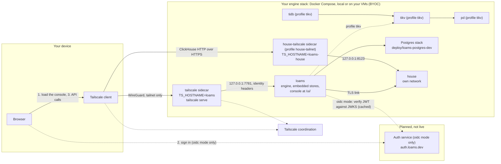

# Running Loams 0.1.4: run the whole stack yourself

Status: **0.1.4**, a patch release of the 0.1 line (0.1.0, the first release, shipped on
2026-10-19, after v0.1.0-preview.1 on 2026-10-12 and v0.1.0-preview.2 on 2026-10-15; 0.1.1 on
2026-10-22, 0.1.2 on 2026-10-26, 0.1.3 on 2026-10-29). What changed is in [What is new in 0.1.4](#what-is-new-in-014),
[What is new in 0.1.3](#what-is-new-in-013),
[What is new in 0.1.2](#what-is-new-in-012), [What is new in 0.1.1](#what-is-new-in-011), [What is new in 0.1.0](#what-is-new-in-010) and
the [changelog](../../CHANGELOG.md).
Everything listed as **Available** or **Experimental** in the
[feature status table](#feature-status) ships in this release.

0.x means APIs, on-disk formats and flags may change between minor versions. Upgrades are
supported: `loams upgrade` moves a stack from one release to the next and keeps its data (see
[upgrades](upgrades.md)). **Experimental** features work and are tested in CI, but may change
more, or be reworked, before they settle. Parts of the security model are not hardened yet (see
[Security model](#security-model)).

Loams ships one path: **your own Tailscale tailnet, with the console served by your own
engine**. You run the Loams stack, and the console ships with it: the engine serves the
console built into its image at `https://loams.<tailnet>.ts.net/ui/`, next to its API (from
0.1.2; the 0.1.1 images do not serve `/ui/`), and Loams Desktop carries the same console. We host nothing you need to run it: `auth.loams.dev` (Zitadel, for the
optional `oidc` mode) is planned and does not answer yet. The hosted console at `console.loams.dev` is retired (design 78); to try Loams without
running anything, see [loams.dev/cloud](https://loams.dev/cloud).

| Piece | Who runs it | Where |
|---|---|---|
| The engine stack: `loams` on its embedded stores, the House, the Postgres stack, agentd (TiDB, TiKV and PD with the `tikv` profile) | **You** | Docker Compose on your laptop, or on your own VMs (BYOC) with `deploy/release/byoc/install.sh` over SSH |
| The private network between your devices and the stack | **You** | Your own Tailscale tailnet |
| The console | **You**: it ships in the engine image and in Loams Desktop | `https://loams.<tailnet>.ts.net/ui/`, served by your engine, and Loams Desktop on your device |
| An OIDC issuer, only for `oidc` mode | **You** (Zitadel at `auth.loams.dev` is planned, not live) | Your own issuer |

The engine is never exposed on the public internet. Your browser reaches it over the tailnet,
through the Tailscale client on your own device.

**Coming soon, not in this release:** the console on your own Vercel or Cloudflare project,
self-service OIDC clients (`auth.loams.dev/register`), Headscale networks, one-click OAuth
deploy.

## What is new in 0.1.4

Everything new is **preview**; the default stack is 0.1.3's.

- **Cost attribution (design 84):** what each engine, tenant, project and query class costs,
  from amortised hardware, imported bills (FOCUS, AWS CUR, CSV) and a price table, allocated
  exactly over Loams Meter usage. Every number carries its basis and a trace. `loams cost`
  works offline from files: `report`, `import` (a dry run) and `export` (FOCUS 1.3, OpenMeter).
- **Resumable transfers and job runs in Loams Desktop (design 85):** the Transfers page and the
  bundled `loams-transfer` sidecar move files of 10 GiB and more in checksummed chunks over
  HTTP/3 (QUIC), with an HTTP/2 fallback, and resume after a crash or a lost network. The engine
  serves the routes on its main port behind its authentication, and HTTP/3 on UDP at that port
  when it has a TLS certificate. `loams-transfer.exe` is not signed by SignPath yet (D2449).
- **Loams Meter follow-ups:** the lease gate on the produce paths, reconciliation against the
  House pipe's cursor, and balances on any node. Threshold and access notifications reach the
  console, and email when `LOAMS_METER_MAIL_FROM` and `LOAMS_METER_RESEND_API_KEY_FILE` (a
  sending-only Resend key) are set. The Stripe, Lago and OpenMeter exports run on a 5-minute
  schedule ([guide](../guides/meter-exports.md)). The meter needs a source build with the
  `loams` feature `meter`; the release images do not include it.
- **The cluster CA (design 83)** and `loams ca`, behind the off-by-default `transport` feature.
  No cluster traffic uses it yet.
- **Postgres 18 is still beta, and still only gates.** New projects stay on 16 or 17. The
  `postgres-control` profile carries the pageserver's upcalls to pg-control.
- **RisingWave is locked to the free tier** with an empty licence key file (D1901).
- **Security:** Dependabot alerts fixed across Rust, Go, npm and pip, and ten CodeQL findings.

See the [changelog](../../CHANGELOG.md) for the full list.

## What is new in 0.1.3

Everything new is **preview** and off by default; the default stack is 0.1.2's.

- **Managed engines (design 81):** RisingWave, Flink SQL and Spark as compose profiles behind
  `loams-gateway`, with `loams risingwave|flink|spark` and the console's Engines pages.
- **The Temporal gateway** as the `temporal-gateway` profile, with schedules, visibility, updates,
  batch operations and SDK legs for Go, TypeScript, Python, Java, .NET, Ruby, PHP and Rust
  ([guide and matrix](../guides/durable/temporal-gateway.md)). Airflow and DBOS run on Loams
  Postgres.
- **Loams Meter:** usage metering, entitlement gates, the billing view and exporters (Stripe,
  OpenMeter, Lago). Webhook secrets are sealed with `LOAMS_METER_SECRETS_KEY_FILE` (default
  `<data_dir>/meter/secrets.key`, made on first use); on a multi-node cluster every gateway node
  must mount the same file.
- **The gateway** serves HTTP/2 (h2c) and pipelined HTTP/1.1 on its HTTP listeners, and speaks the
  Redis protocol on Loams KV (`--module resp`).
- **Connectors and Confluent Cloud for BYOC** (the `connectors` profile), and a fix for duplicate
  events when a connector's request is cut off mid-append.
- **Authorization through OpenFGA** (the `authz` profile) and **a headless browser for agents**
  (the `browser` profile).

See the [changelog](../../CHANGELOG.md) for the full list.

## What is new in 0.1.2

- **The console ships with your stack.** The engine serves the console built into its image at
  `https://loams.<tailnet>.ts.net/ui/`, same-origin with its API, so a browser on your tailnet
  is all you need; Loams Desktop carries the same console. `console.loams.dev` is retired, and
  `LOAMS_CORS_ORIGINS` allows no other origin by default.
- **Studio in the browser with a remote agentd:** list the host in `LOAMS_AGENTD_ORIGINS` and
  the engine adds it to the console's `connect-src` and `frame-src`, so calls and previews work
  ([remote agentd](../guides/studio/remote-agentd.md)). `loams-agentd` for Linux ships as release
  tarballs.
- **CLI packages install on Fedora and Arch:** the `.rpm` and pacman packages declare their own
  distribution's dependency names, zlib included.
- **The `kafka` profile (preview):** Kafka clients on `127.0.0.1:9093` through Ostrium's Iggy fork
  ([profiles](#profiles-tikv-rustfs-and-kafka)); not wired to the engine yet.
- **Loams House** takes more of Langfuse's and SigNoz's schemas and queries on lake tables.
- **BYOC on AWS, Google Cloud and Azure (preview):** cloud-init, OpenTofu modules and guides for
  one VM with no inbound rule and no static cloud key; not yet run on a real cloud account.
- **Fixes and security:** agentd run groups settle after a restart, TiKV garbage collection and
  crashed-writer locks, the CodeQL alerts open at 0.1.1, and RUSTSEC advisories in rustls-webpki
  and tokio. See the [changelog](../../CHANGELOG.md).

## What is new in 0.1.1

- **The UI upgrade.** The console, Studio and Loams Desktop share the design 59 foundation:
  new tokens, component states and motion, a reworked shell (sidebar, inspector, drawer,
  palette, one keymap), and on the desktop native menus, per-OS window chrome, a splash, OS
  notifications and an update toast.
- **The app-building API in every SDK.** All 13 SDKs (TypeScript, Python, Go, Rust, C#, C++,
  Swift, Java, Kotlin, Ruby, PHP, Dart, Objective-C) have namespaces, collections, documents,
  search, vector and graph modules, the `Schema`, `Filter` and `Search` builders, consistency
  tokens with a session store, a default namespace and client deadlines, plus `sql` and
  `streams`, each checked against one recorded app scenario.
- **`loams.sql.v1` and `loams.stream.v1`** on the engine's main port: read-only SQL with `$n`
  parameters (rows or Arrow), and streams with keyed records, idempotent produce and long-poll
  fetch.
- **Self-host first-run fixes.** The setup token reaches the engine from `.env`, and the
  one-shot `pg-bootstrap` creates `compute1`'s tenant and timeline, so a fresh stack comes up
  without manual steps, from the bundle or from the tag.
- **A light default stack.** `docker compose up -d` runs the engine on its embedded stores
  with a local-folder bucket, the House, Git, Loams Postgres on local folders and agentd: about
  8 GB of images and 1 GB of RAM at idle. PD, TiKV and TiDB are the `tikv` profile and RustFS
  the `rustfs` profile ([profiles](#profiles-tikv-rustfs-and-kafka)).
- **Mastra compatibility:** the Qdrant gateway serves `DELETE` of a payload index.
- **Fixes:** agentd keeps an orphaned steer ahead of the queue, so queued messages no longer run
  out of order.

## What is new in 0.1.0

- **Upgrades that keep data.** `loams upgrade check|--to|rollback|status|snapshots` upgrades a
  self-hosted compose stack one release at a time. It snapshots every store first, runs the
  release's migrations in a one-shot `migrate` service, restarts in order and verifies, and
  rolls back on a failure. See [upgrades](upgrades.md).
- **Loams Studio** (experimental): coding agents in threads, each with its own git worktree,
  with diff review, git actions, checkpoints, terminals, previews, supervised approvals and
  parallel run groups, through `loams-agentd`'s Connect API. Loams Desktop opens in Studio; in
  the browser it runs against a remote daemon behind the instance feature `studio`.
- **Git push and fetch to the bucket** (experimental): `git-remote-loams` ships next to `loams`
  in the Linux packages, the macOS tarballs and the Windows zip.
- **Loams House** (experimental) is wired to the engine over TLS on a private network
  (`LOAMS_HOUSE_ENDPOINT`), writes lake tables (`INSERT`, `INSERT … SELECT`,
  `CREATE TABLE … AS SELECT`, `TRUNCATE`) and compacts them (`OPTIMIZE TABLE`).
- **Loams Postgres's control plane** in the stack: `--profile postgres-control` runs
  `pg-control` and a separate compute runner, `pg-runner`.
- **Loams Live** on the engine's main port, over the tailnet: many apps per engine, per-app and
  per-table authorization, end users from any OIDC provider, sessions that follow who is signed
  in, TLS on the main port and several nodes serving one store.
- **`loams-agentd` supervises new threads by default**, on your own machine too: existing local
  users will see approval prompts for threads that used to run unattended (see the
  [changelog](../../CHANGELOG.md)).

## Desktop and CLI

Download from the [GitHub release](https://github.com/ostrium-labs/loams/releases) and check
the files against `DESKTOP-SHA256SUMS` (desktop) or the release checksums (CLI).

| Platform | Loams Desktop | `loams` CLI |
|---|---|---|
| Linux x64, arm64 | `.deb`, `.rpm`, `.pacman`, `.AppImage` | `.deb`, `.rpm`, `.pkg.tar.zst` |
| macOS arm64, x64 | `.dmg`, `.zip` | `.tar.gz` |
| Windows x64 | NSIS installer, `.zip` | `.zip` |

Builds that are not signed by a trusted certificate (the release notes say which):

- **macOS:** ad-hoc signed, not notarized. After installing, run
  `xattr -dr com.apple.quarantine /Applications/Loams.app` (or the CLI binary) once.
- **Windows:** unsigned. SmartScreen shows "Windows protected your PC": choose
  **More info → Run anyway**.

The server stack stays Linux containers: on macOS and Windows run `deploy/release` with Docker
Desktop. The patched TiDB image is amd64-only and runs emulated on Apple silicon.

## SDKs

The seven supported SDKs are released from this tag by one workflow (`sdk-release.yml`).
Each registry below serves 0.1.4 once the release workflows have run.

| SDK | Install | Version |
|---|---|---|
| TypeScript | `npm i @loams/client` (and `@loams/live`) | `0.1.4` |
| Python | `pip install loams` | `0.1.4` |
| Rust | `cargo add loams` | `0.1.4` |
| C# | `dotnet add package Loams` | `0.1.4` |
| Go | `go get loams.dev/go@v0.1.4` (Go 1.25+) | `0.1.4` |
| Swift | SwiftPM: `https://github.com/ostrium-labs/loams`, from `0.1.4` | `0.1.4` |
| C++ | `loams-cpp-0.1.4.tar.gz` from the GitHub release (CMake `find_package(loams)`) | `0.1.4` |

Java and Kotlin (`dev.loams:loams`, `dev.loams:loams-kotlin` on Maven Central) and Ruby
(`gem install loams`) are published as `0.1.4` too, as experimental SDKs. PHP, Dart and
Objective-C stay in the repository (coming soon).

## Architecture



1. The browser loads the console's static files from your engine, at
   `https://loams.<tailnet>.ts.net/ui/`, over the tailnet (Loams Desktop has them built in).
   The console holds no data and no secrets.
2. In the default `tailscale` mode there is no separate sign-in: the console calls your
   engine and Tailscale tells the engine who you are. In `oidc` mode the console signs you
   in with Authorization Code + PKCE against the auth service; tokens live in memory only,
   never in `localStorage`.
3. The console calls your engine at `LOAMS_ENGINE_URL`, a tailnet URL such as
   `https://loams.<tailnet>.ts.net`. The request leaves your browser through your device's
   Tailscale client and reaches the stack's `tailscale` sidecar. Off the tailnet the URL does
   not resolve and nothing answers.
4. In `oidc` mode the engine verifies the token against the issuer's JWKS (fetched outbound,
   cached). The auth service never connects to your stack, and never sees your data.

## Feature status

**Available** means it ships in the 0.1.4 images and packages and is built and tested in CI; as with all of 0.x, APIs and formats may change between minor versions, with `loams upgrade` to move between them. **Experimental** ships too, but may change more before it settles. **In progress** and **Planned** do not ship in 0.1.0.

| Feature | What you get | Status |
|---|---|---|
| Collections | Documents with a schema, stored as Lance (vectors, columns) plus Tantivy (full text) under one manifest; upserts and deletes by id | Available |
| Hybrid retrieval | Vector kNN, BM25 and filters fused with RRF in one query; SQL table functions `vector_search`, `text_search` and `rrf` | Available |
| Native REST API | Namespaces, streams, collections, links, hybrid query and SQL | Available |
| Arrow Flight SQL | SQL and Arrow results for any language with an ADBC or Flight SQL driver | Available |
| Qdrant API | Qdrant REST and gRPC, tested with `qdrant-client` 1.15 and 1.19 | Available |
| Elasticsearch subset | Document APIs, `_bulk`, `_search` with the core Query DSL, `knn`, hybrid and RRF, tested with `elasticsearch-py` 8.19 | Available |
| Streams and links | Partitioned streams with a native produce and fetch API; links apply streams to targets exactly once | Available |
| Hot tier | HNSW vector artifacts and pinned text splits in RAM and NVMe, with delta indexes for fresh writes | Available |
| Pinned scans | Read a collection's pinned Lance version directly with pylance, Ray, Polars or PyTorch | Available |
| Cluster mode | `loams cluster` with roles, rendezvous placement, read forwarding and write backpressure | Available |
| TiKV metastore | The catalog, leases and timestamp oracle on TiKV (`--meta tikv://…`, cargo feature `tikv`) | Available |
| Loams Durable | An embedded Resonate server: durable promises and tasks on SQLite (cargo feature `durable`) | Available |
| Durable store on TiKV | Durable execution state on TiKV for clusters | In progress |
| Loams Live | A reactive document database: transactions, indexes, live queries and a TypeScript SDK, on an embedded store or on TiKV (`live-tikv`) | Available. Deploys, rollback, validators and online index changes through `LiveAdminService` on the main port, over the tailnet; many apps per engine, per-app and per-table authorization, end users from any OIDC provider; a deploy reaches every node at once |
| Loams Graph | `loams.graph.v1` on the main port, GQL on Grafeo (cargo feature `graph`) | Available. Writes reach the Loams log before they are acknowledged, with a fenced single owner per graph, snapshots in the bucket and crash recovery (GR1 Tasks 11 to 14), on Loams' Grafeo fork |
| Loams House | ClickHouse-compatible analytics on chDB in `loams-fabric`, with `loams.house.v1` proxied by the engine | Experimental. On by default and linked to the engine; the `house-tailnet` profile serves its ClickHouse HTTP interface on your tailnet through its own sidecar, with chDB access control, statement checks and sealed workers. With `LOAMS_HOUSE_ENDPOINT` the engine reaches it over TLS on a private network; lake tables take `INSERT` (every declared format, `VALUES`, `SELECT`), `CREATE TABLE … AS SELECT`, `TRUNCATE` and `OPTIMIZE TABLE` |
| Loams SQL | MySQL-compatible SQL on a patched TiDB (`v8.5.8-loams.1`) over TiKV | Available with the `tikv` profile |
| Loams Postgres | A fork of Neon whose storage lives on the bucket; the compose stack runs its storage and computes | Available. The compose stack runs its storage and computes; `--profile postgres-control` adds `pg-control` and `pg-runner`, which provision computes and endpoints |
| Postgres and MySQL wire | SQL over the Postgres and MySQL wire protocols, over collections | Available |
| Streaming gRPC API | Idempotent produce and streaming subscribe over gRPC | Available |
| Web console | One console of cordis plugins on Connect, served by your engine at `/ui/` (from 0.1.2) and in Loams Desktop, with a Studio mode (on in Loams Desktop; in the browser behind the instance feature `studio`, which no Loams server sets yet; [Studio guides](../guides/studio/index.md)); sign-in from your tailnet login, a Loams account or an API key. Your own Vercel or Cloudflare deployment is coming soon | Available. Studio mode is experimental. Some pages still show demonstration data |
| Engine auth | Tailscale identity (default), OIDC (JWTs checked against the issuer's JWKS), hashed API keys, or loopback-only (`LOAMS_AUTH_MODE`) | Available |
| Loams Git | Git on the bucket: a WAL, ref log, checkpoints, O(1) forks and GC, and `loams.repos.v1`'s repository catalog (cargo feature `git`) | Experimental. `git-remote-loams` ships with the `loams` CLI packages and pushes and fetches straight to a bucket, and its first push creates a repository (`LOAMS_GIT_CREATE_ON_PUSH=1`; the URL names the namespace by its numeric id, see [packaging](packaging.md#git-push-and-fetch-to-the-bucket)); the engine image serves the repository service (`loams.repos.v1`) on the main port from 0.1.1 (feature `git`) |
| First-party connectors | Native source and sink connectors (Kafka family, Postgres CDC, object storage, key-value, search, brokers, cloud queues, HTTP APIs) on `loams-connector-sdk` | In progress. Not in the release images |
| Self-hosting with Docker Compose | The whole stack in `deploy/release/compose.yaml`, reachable only over your Tailscale tailnet, locally or on your VMs with `byoc/install.sh` over SSH | Available. Headscale is coming soon |
| Graph expansion | GraphRAG expansion of 1 to 2 hops from a retrieval query's hits: the `expand` stage of a search (REST and Connect), and the SQL table functions `graph_expand`, `graph_neighbors`, `graph_degree` and `graph_shortest_path` | Experimental. Runs on a Loams Graph (cargo feature `graph`, in the release `loams` image); the caller needs `reader` on each graph it touches (GR1 R24.12). The SDKs and the MCP `search` tool do not expose it yet (GR1 Task 36), and a UUID-keyed collection's neighbors come back without their documents |
| Iceberg analytics | Iceberg tables through a REST catalog, readable by DuckDB, Spark, Trino and ClickHouse | Planned |
| Kafka wire (`kafka` profile) | Kafka clients (kcat, librdkafka, the Java client, Kafka Connect, Flink) on `127.0.0.1:9093` through the Kafka gateway of Ostrium's fork of Apache Iggy, in front of its own Iggy server | Preview. Optional compose profile, never in the default stack; every Kafka API except transactions and exactly-once (planned, not built). Not wired to the engine yet ([guide](../guides/kafka.md)) |
| OTLP | OpenTelemetry logs ingest into streams | Planned |
| Authorization and tenancy | Roles, per-namespace authorization, tenant quotas and a namespace router | Planned |
| Native SDKs | TypeScript, Python, Go, Rust, C#, Swift and C++ clients with generated API bindings and shared runtime conformance fixtures, published as `0.1.4` (see [SDKs](#sdks)) | Available. Java, Kotlin, Ruby, PHP, Dart and Objective-C are in progress |
| MCP and analytics helpers | Agent tools and convenience integrations such as `to_arrow()` and `to_polars()` | Planned |
| Loams Functions | A CPU-time serverless runtime on workerd, wasmtime and gVisor, with a Rust Dapr-style API | Planned |
| Loams Jobs | Celery, BullMQ v6, PySpark (through Sail) and Flink SQL (through RisingWave) jobs run durably on Loams | Planned |
| Self-hosting with GitOps | A Helm chart, a Kubernetes operator and Argo CD layouts | Planned |

## What is in the stack

The compose file is [`deploy/release/compose.yaml`](../../deploy/release/compose.yaml), with
its settings in `deploy/release/.env.example`.

The default stack is the light one; profiles, set in `.env` as `COMPOSE_PROFILES`, add the
rest (see [the profiles](#profiles-tikv-rustfs-and-kafka)).

| Service | Image | Role |
|---|---|---|
| `loams` | `ghcr.io/ostrium-labs/loams` | The engine, built with `live,live-tikv,durable,durable-tikv,graph,git,tikv,pgwire,mysql-wire,stream-grpc`. By default on its embedded stores in the `loams-data` volume: the metastore on openraft + redb, Live on redb, Durable on SQLite, the bucket a local folder; Loams Git and Graph on the bucket |
| `migrate` | `ghcr.io/ostrium-labs/loams` | One-shot, before the engine: the release's migrations |
| `house` | `ghcr.io/ostrium-labs/loams-fabric` | Loams House (the front, with `loams-house-worker` inside), on a network of its own and a private TLS link to the engine (`LOAMS_HOUSE_ENDPOINT`, on by default) |
| Postgres stack | pinned in `deploy/pins/loams-postgres-images.toml` | Included from [`deploy/loams-postgres-dev`](../../deploy/loams-postgres-dev/README.md): `storage_broker`, `pageserver`, `safekeeper1`, the one-shot `pg-bootstrap` and `compute1`, with their remote storage in local folders |
| `agentd` | `ghcr.io/ostrium-labs/loams-agentd` | The agent daemon |
| `pd` (profile `tikv`) | PD | TiKV's placement driver |
| `tikv` (profile `tikv`) | TiKV | The metastore and Live with the profile, and TiDB's storage |
| `tidb` (profile `tikv`) | `ghcr.io/ostrium-labs/tidb:v8.5.8-loams.1` | Loams SQL (MySQL compatible) |
| `rustfs`, `create-bucket` (profile `rustfs`) | RustFS | An S3 bucket for the Postgres stack's remote storage |
| `iggy`, `kafka-gateway` (profile `kafka`, preview) | `ghcr.io/ostrium-labs/iggy@sha256:…` (one image, pinned by digest) | Kafka clients on `127.0.0.1:9093`: the Kafka gateway of Ostrium's Iggy fork, and its Iggy server. See [Kafka](../guides/kafka.md) |
| `house-tailscale` (profile `house-tailnet`) | `tailscale/tailscale` | The House's own door: joins the tailnet as `loams-house` and serves its ClickHouse HTTP interface there |
| `console` (profile `console`, optional) | static console | A copy of the console on an origin of its own, for local trials; the engine already serves one at `/ui/` |
| `tailscale` | `tailscale/tailscale` | The stack's only door: joins the tailnet as `loams` and serves the engine there |
| `headscale` (profile `headscale`) | Headscale | Coming soon, unsupported in this release (see [the tailnet](#the-tailnet)) |

Images are tagged `0.1.4`, `0.1` and `:latest`. The compose file pins `0.1.4` through
`LOAMS_VERSION`. The patched TiDB image
`ghcr.io/ostrium-labs/tidb:v8.5.8-loams.1` is public and amd64 only.

Only the `tailscale` service (and, with the `house-tailnet` profile, `house-tailscale`) is reachable
from outside the compose network, and only over your tailnet. Nothing binds `0.0.0.0` on the
host by default.

## Quick start: fully local

You need Docker with the Compose plugin **v2.24.0 or later** (the bundle's `env_file` entries
use `required: false`, added in 2.24.0; `include` and optional `depends_on` need 2.20), about 10 GB of free disk (8 GB of images, and room for data) and 2 GB of free
memory for the default stack (it idles near 1 GB), and the Tailscale client on the machine
whose browser you will use. The `tikv` profile adds about 3 GB of images and 2 GB of memory
(TiKV alone idles near 1.8 GB), and TiKV refuses writes when its disk is nearly full. Measured on 0.1.0's images with Podman; your numbers will
differ with load.

Use the files of the release you run, so `compose.yaml` matches the images that
`LOAMS_VERSION` pins. Download the compose bundle attached to the release; this is the
supported path, and the bundle carries the first-run fixes below:

```sh
curl -fLO https://github.com/ostrium-labs/loams/releases/download/v0.1.4/loams-compose-0.1.4.tar.gz
tar -xzf loams-compose-0.1.4.tar.gz
cd loams-compose-0.1.4/release
cp .env.example .env
```

**From a git checkout instead.** Clone the tag; from 0.1.1 its `deploy/release` has the same
first-run fixes as the bundle (the setup token's pass-through, [First-run setup](#first-run-setup),
and the Postgres bootstrap, [Postgres: first run](#postgres-first-run)):

```sh
git clone --branch v0.1.4 https://github.com/ostrium-labs/loams.git
cd loams/deploy/release
cp .env.example .env
```

The `v0.1.0` tag predates both: on it, put the token in `secrets/engine.env`, and create
`compute1`'s tenant and timeline by hand (see
[`deploy/loams-postgres-dev/README.md`](../../deploy/loams-postgres-dev/README.md#run)).

Edit `.env`:

- `TS_AUTHKEY`: an auth key from your Tailscale admin console (Settings, Keys). A tagged,
  non-ephemeral, single-use key is the right shape; see [the tailnet](#the-tailnet).
- `TS_HOSTNAME=loams`: the stack's name on the tailnet. Keep it unless you run two stacks.
- `LOAMS_AUTH_MODE`: `tailscale` by default. Set `LOAMS_TAILSCALE_ALLOWED_USERS` to narrow
  who is admitted: Tailscale logins, comma-separated, case-insensitive (for example
  `alice@example.com,bob@github`). See [Auth modes](#auth-modes).
- `LOAMS_SETUP_TOKEN`: a random secret for [first-run setup](#first-run-setup), for example
  the output of `openssl rand -hex 32`. Every mode except `off` turns authentication on, and
  with authentication on the engine refuses first-run setup without this token. Set it in
  `.env` or in `secrets/engine.env`; when both set it, `secrets/engine.env` wins.

Then start it:

```sh
docker compose up -d
docker compose ps                                   # every service running (see below)
docker compose exec tailscale tailscale status      # the stack is on your tailnet
```

`docker compose ps` lists the long-running services. The one-shot services `migrate`,
`pg-bootstrap` (and `create-bucket`, with the `rustfs` profile) run first and exit 0 by design (`docker compose ps -a` shows
them as `Exited (0)`); a non-zero exit is a failure, and `docker compose logs <service>` says why.

The engine's URL is `https://<TS_HOSTNAME>.<tailnet>.ts.net`, by default
`https://loams.<tailnet>.ts.net`.

Enable **MagicDNS** and **HTTPS certificates** for your tailnet (Tailscale admin console, DNS),
so the sidecar can serve `https://loams.<tailnet>.ts.net`. Install
[Loams Desktop](#desktop-and-cli) on a device that is on the same tailnet, and enter that URL
as your engine, or open `https://loams.<tailnet>.ts.net/ui/` in a browser on the tailnet: the
engine serves the console there. (`console.loams.dev` is retired.)

From the CLI or an SDK, set `LOAMS_AUTH_MODE=apikey`, create a key with `loams auth new-key`
and use the same tailnet URL. The engine runs as uid and gid 10001, so give it read access to
`secrets/api-keys` ([API keys](../../deploy/release/README.md#api-keys)).

To stop, `docker compose down`. Your data stays in the compose volumes; `docker compose
down -v` deletes it.

### Cloud VM requirements

For [BYOC](#byoc-your-own-vm-over-ssh) and any cloud host. Items marked (verify) come from
the providers' documentation and have not been tested against this stack.

- **Linux kernel 6.7 or later** for the House's workers: the `pods` sandbox needs Landlock
  with TCP rules, and on an older kernel the workers refuse to boot (confirmed in
  `deploy/release/compose.yaml`). Use **Ubuntu 24.04**. Debian 12 (kernel 6.1) and Amazon
  Linux 2023's default kernel (6.1) are too old (verify the exact kernel on your image).
- **AWS EC2, instance role used from a container:** set the instance metadata
  `HttpPutResponseHopLimit` to **2**. With IMDSv2 and the default hop limit of 1, a container
  cannot reach the role's credentials (verify).
- **GCE, Cloud Storage:** the default access scopes give Cloud Storage **read-only**. The
  engine writes objects, so create the VM with the `storage-rw` scope or the `cloud-platform`
  scope, or use a service account key (verify).
- **Docker Compose v2.24.0 or later** (see the quick start). Distribution packages are often
  older; install the Compose plugin from Docker's repository.

### Profiles: tikv, rustfs and kafka

Set profiles in `.env`, comma-separated, before the first start:

```sh
# .env
COMPOSE_PROFILES=tikv,rustfs
```

- **`tikv`**: PD, TiKV and TiDB. Loams SQL (MySQL compatible, on `tidb:4000` inside the
  stack) needs it. The engine's metastore and Live move onto TiKV (keyspaces `loams_meta` and
  `loams_live_dev`), for more than one engine and for data larger than one machine's disk.
  Durable stays on SQLite unless `LOAMS_DURABLE_STORE=tikv://pd:2379/loams_durable`.
- **`rustfs`**: RustFS, an S3 bucket (`neon`) for Loams Postgres's pageserver, safekeeper and
  endpoint storage, instead of local folders in their volumes. For the engine's own bucket,
  point `LOAMS_BUCKET` at any S3 store ([the bucket](#the-bucket-a-local-directory-or-s3)).

- **`kafka`** (preview): Kafka clients on `127.0.0.1:9093`. It runs Ostrium's fork of Apache
  Iggy (`ghcr.io/ostrium-labs/iggy`, pinned by digest in `IGGY_KAFKA_IMAGE`): `iggy` is the
  broker's storage and `kafka-gateway` speaks the Kafka wire. Optional and off by default, so
  the default stack stays light; add about 1 GB of image and some memory. Transactions and
  exactly-once are not supported. Set `KAFKA_IGGY_PASSWORD` in `.env` first: the profile
  refuses to start on `.env.example`'s placeholder. See [Kafka](../guides/kafka.md).

Use `COMPOSE_PROFILES` rather than `--profile` on the command line: a `--profile` flag
replaces the list, and the engine, `migrate` and `loams upgrade` read the list from `.env`.
A stack's data stays on the stores it started on. The engine records its store in the
`loams-data` volume and refuses to start on the other one, and Loams Postgres's timelines stay
in the remote storage they were created in; moving between them is a dump and a restore.

### Durability of the default stack

The default stack is one node on one disk, and it is honest about it:

- **The embedded metastore** (openraft with one voter, its log and state in redb) fsyncs every
  commit and keeps its snapshots in the bucket. It has no replica: losing the disk loses the
  catalog. There is no failover.
- **Live** (redb) and **Durable** (SQLite) commit to the same disk, with the same limits.
- **The bucket** is a folder in the `loams-data` volume, and **Loams Postgres's remote
  storage** is a folder in the pageserver's and the safekeeper's volumes (Neon's `LocalFs`): one
  copy, beside the data it backs.

Back up the volumes (stop the stack, then copy them, or snapshot the disk), or keep the
bucket on S3 (`LOAMS_BUCKET=s3://…`). For replication and failover, run the `tikv` profile
and an S3 bucket, and see the clustered layouts in the design docs.

### First-run setup

A new engine has no organization. First-run setup (`AuthService/CompleteSetup`) creates it,
with you as its owner, and runs once. With authentication on (`tailscale`, the default, or
`oidc` or `apikey`) it needs `LOAMS_SETUP_TOKEN`; without it the engine answers
`first-run setup on an engine with authentication on needs LOAMS_SETUP_TOKEN; set it and
restart`, and the console does not offer setup at all. If you started the stack before setting
the token, add it to `.env` (or `secrets/engine.env`) and recreate the engine with
`docker compose up -d loams`.

**In the console.** Open the console with your engine URL. While the engine has no
organization and a setup token is set, the console opens on **Set up this install**
(`#/setup`). Enter the setup token (the value of `LOAMS_SETUP_TOKEN`), the
organization name, your name, your email and a password of 12 characters or more. The console
signs you in as the owner.

**From the command line.** The same call from inside the engine's container, over its
loopback port, reading the token from the engine's environment so it never appears on your
command line:

```sh
# Is setup still to do? Prints "setupRequired":true until it has run.
docker compose exec loams curl -sS http://127.0.0.1:8080/loams.instance.v1.InstanceService/GetInstance \
  -H 'content-type: application/json' -d '{}'

docker compose exec -e ORG='Acme' -e NAME='Your Name' -e EMAIL='you@example.com' \
  -e PASSWORD='at-least-12-characters' loams sh -c '
  curl -sS http://127.0.0.1:8080/loams.auth.v1.AuthService/CompleteSetup \
    -H "content-type: application/json" \
    -d "{\"setupToken\":\"$LOAMS_SETUP_TOKEN\",\"orgName\":\"$ORG\",\"name\":\"$NAME\",\"email\":\"$EMAIL\",\"password\":\"$PASSWORD\"}"'
```

A wrong token is refused with `permission_denied`. After setup has run, every further
`CompleteSetup` is refused with `setup has already run`, whatever the token, so you can empty
`LOAMS_SETUP_TOKEN` where you set it and run `docker compose up -d loams` to drop it from the
engine.
With `LOAMS_AUTH_MODE=off` setup needs no token, and only loopback clients can reach it.

### Postgres: first run

The Postgres stack's compute (`compute1`) attaches to a tenant and a timeline on the
pageserver. You do not create them: on the first `docker compose up -d` the one-shot
`pg-bootstrap` service creates both (Postgres 17), keeps their ids in the `pg-bootstrap`
volume, and exits 0; `compute1` starts after it. Every later `up`, including after a
`docker compose down` without `-v`, reuses the same ids, so your data is where you left it.

```sh
docker compose logs pg-bootstrap          # pg-bootstrap: ready: TENANT_ID=... TIMELINE_ID=...
PGPASSWORD=cloud_admin psql -h 127.0.0.1 -p 55433 -U cloud_admin postgres -c 'SELECT version()'
```

To bring your own tenant and timeline (for example ones Loams or an earlier stack created), set
both `TENANT_ID` and `TIMELINE_ID` in `.env` (32 hex characters each) and run
`docker compose up -d compute1`. The ids in `.env` win; `pg-bootstrap` only makes sure they
exist on the pageserver, creating any that are missing, and leaves its stored ids alone.
Setting only one of the two is refused. Empty both to go back to the stored ids.
`docker compose down -v` deletes the tenants together with the stored ids.

### Without a tailnet

For a laptop-only trial with nothing on any network, set `LOAMS_AUTH_MODE=off` and use the
optional local `console` service. `off` is accepted only for loopback clients: the engine
refuses every request that does not come from loopback, so this mode cannot be reached over
the tailnet. Do not use it on a shared machine.

The local `console` service (`--profile console`) serves `LOAMS_CONSOLE_DIR`, by default
`./console/dist`. In the compose bundle that directory holds the console built from the
release's own commit, so there is nothing to build. In a git clone, and in older bundles, it
holds only a placeholder `index.html` that says "Put the built console here". To serve a
console you build yourself, build it from the same checkout for the root path and point
`LOAMS_CONSOLE_DIR` at it:

```sh
# from the repository root
corepack enable
pnpm install --frozen-lockfile
(cd web && LOAMS_UI_BASE=/ pnpm build)   # writes web/apps/console/dist
# then in deploy/release/.env
LOAMS_CONSOLE_DIR=../../web/apps/console/dist
```

`LOAMS_UI_BASE=/` matters: without it the build is the engine's, for `/ui/`, and behind this
service its pages do not find their scripts or `/config.json`.

A console served from your own origin also needs that origin in `LOAMS_CORS_ORIGINS`.

### The bucket: a local directory or S3

`LOAMS_BUCKET` in `.env` is where the engine keeps its data. The default,
`file:///var/lib/loams/bucket`, is the `loams-data` volume. For an object store, set
`LOAMS_BUCKET` to `s3://<bucket>/<prefix>` (or `gs://...`, `az://...`) and put the store's
settings in `secrets/engine.env`, one `KEY=value` per line. The engine and the one-shot
`migrate` service both read that file. The engine reads them the way the backends' own
`from_env()` do: `AWS_*` for S3, `GOOGLE_*` for GCS and `AZURE_*` for Azure. At startup it logs
the bucket, endpoint, region and where its credentials come from, never their values.

The store needs conditional writes (`If-None-Match` and `If-Match` on `PUT`). AWS S3,
Cloudflare R2, GCS, Azure, MinIO and RustFS all support them. The bucket must already exist.

**AWS S3.** Without an endpoint the engine talks to AWS. On EC2 or EKS, leave out the keys
to use the instance role (or `AWS_WEB_IDENTITY_TOKEN_FILE` and `AWS_ROLE_ARN`). Named
profiles (`AWS_PROFILE`, `~/.aws/config`) are not read.

```sh
# .env
LOAMS_BUCKET=s3://my-bucket/loams
# secrets/engine.env
AWS_ACCESS_KEY_ID=AKIA...
AWS_SECRET_ACCESS_KEY=...
AWS_REGION=eu-west-1
# AWS_SESSION_TOKEN=...   for temporary credentials
```

**Cloudflare R2.** Use an R2 API token's S3 credentials and the account's endpoint. The
region is `auto`.

```sh
LOAMS_BUCKET=s3://my-bucket/loams
AWS_ACCESS_KEY_ID=...
AWS_SECRET_ACCESS_KEY=...
AWS_ENDPOINT_URL=https://<ACCOUNT_ID>.r2.cloudflarestorage.com
AWS_REGION=auto
```

**MinIO or RustFS** (or another S3-compatible store). Requests are path style
(`<endpoint>/<bucket>/<key>`) by default, which these stores expect. An `http://` endpoint
allows plain HTTP by itself, so `AWS_ALLOW_HTTP=true` is optional. Set
`AWS_ALLOW_HTTP=false` to refuse plain HTTP even then. Use plain HTTP only on a network
you trust, such as the compose network.

```sh
LOAMS_BUCKET=s3://loams/data
AWS_ACCESS_KEY_ID=rustfsadmin
AWS_SECRET_ACCESS_KEY=...
AWS_ENDPOINT_URL=http://rustfs:9000      # the `rustfs` profile's; AWS_ENDPOINT is accepted too
AWS_REGION=us-east-1                     # any value; these stores ignore it
# AWS_ALLOW_HTTP=true                    # implied by an http:// endpoint
# AWS_VIRTUAL_HOSTED_STYLE_REQUEST=true  # <bucket>.<endpoint> addressing, if your store needs it
```

**Google Cloud Storage.** Put the service account's JSON key, on one line, in
`GOOGLE_SERVICE_ACCOUNT_KEY`. Leave it out on GCE or GKE to use the VM's or the workload's
identity.

```sh
LOAMS_BUCKET=gs://my-bucket/loams
GOOGLE_SERVICE_ACCOUNT_KEY={"type":"service_account",...}
```

**Azure Blob Storage.**

```sh
LOAMS_BUCKET=az://my-container/loams
AZURE_STORAGE_ACCOUNT_NAME=myaccount
AZURE_STORAGE_ACCOUNT_KEY=...
```

On an Azure VM with a managed identity, use no key: set `AZURE_CREDENTIAL_TYPE=managed_identity`
(and `AZURE_STORAGE_CLIENT_ID` for a user-assigned identity) and give the identity
`Storage Blob Data Contributor` on the container. The engine then asks the instance metadata
service for a token. `loams-store`'s unit tests check that this builds without a key; it has
not yet been run against a real storage account. `deploy/byoc/azure/` sets it up (see
`docs/guides/byoc/azure.md`).

If writes fail with `Error performing PUT http://169.254.169.254`, the engine found no
credentials and asked the cloud metadata service, which answers only on a cloud VM. Check
that `secrets/engine.env` exists and sets `AWS_ACCESS_KEY_ID` and `AWS_SECRET_ACCESS_KEY`.
The engine also logs a warning at startup when an S3 bucket has an endpoint but no access key.

## BYOC: your own VM over SSH

The stack is the same on a VM: one VM for a trial, or the services split across VMs that share a
tailnet. The VM needs no inbound port other than SSH, and SSH itself can move onto the tailnet
once the stack is up.

From a checkout on your own machine, `deploy/release/byoc/install.sh` does it over SSH: it
installs Docker if missing, copies the compose bundle, writes `.env` (asking for your
Tailscale auth key, and generating a `LOAMS_SETUP_TOKEN` for [first-run setup](#first-run-setup),
which it does not print) and starts the stack. Read the token on the VM with
`grep LOAMS_SETUP_TOKEN ~/loams/release/.env` (`~/loams` is the default `--dir`).

```sh
deploy/release/byoc/install.sh -i ~/.ssh/id_ed25519 you@your-vm
```

By default it starts the light default stack (the engine, the House, the Postgres stack and
agentd). `--tikv` adds PD, TiKV and TiDB, `--rustfs` RustFS, `--all` both, `--profiles` any
other profiles, and `--no-postgres` leaves the Postgres stack out; they are written into the
new `.env` as `COMPOSE_PROFILES`, so choose them on the first install. `--version` picks the
image tag (default `0.1.4`).
`byoc/uninstall.sh` removes it. To do it by hand instead, copy `deploy/release` to the VM,
`cp .env.example .env`, set `TS_AUTHKEY` and `LOAMS_SETUP_TOKEN`, and run `docker compose up -d`.

Your device then reaches the engine at `https://loams.<tailnet>.ts.net`, exactly as in the
local quick start. Nothing on the VM listens on its public address.

### The tailnet

**Tailscale.** Create an auth key in the admin console (Settings, Keys), tagged for example
`tag:loams`, and put it in `TS_AUTHKEY`. Add a policy rule that lets your own devices reach
`tag:loams` on port 443, and nothing else reach it. Leave `TS_LOGIN_SERVER` empty.

**Headscale: coming soon, unsupported in this release.** The `headscale` profile and
`TS_LOGIN_SERVER` exist in the compose file, but Headscale issues no `*.ts.net` HTTPS
certificates, so the engine is served over plain HTTP there, and a console on another HTTPS
origin cannot call it: the browser blocks it as mixed content. Use Tailscale.

## The console on your own Vercel or Cloudflare: coming soon

Hosting the console on your own Vercel or Cloudflare project is not part of 0.1.4.
Use the console your engine serves at `/ui/`, or Loams Desktop. Likewise not in this release: self-service OIDC clients at
`auth.loams.dev/register` and one-click OAuth deploy.

## Loams House

The House runs by default, linked to the engine. The `house-tailnet` profile
(`COMPOSE_PROFILES=house-tailnet` in `.env`) adds its own tailnet sidecar. Give the sidecar its own
auth key in `HOUSE_TS_AUTHKEY` (or leave it empty to reuse `TS_AUTHKEY`, which must then be
reusable); it joins the tailnet as `HOUSE_TS_HOSTNAME` (`loams-house`). Then, from a device on
the tailnet:

```sh
docker compose exec house cat /var/lib/loams-house/house.key    # the password, made on first start
curl -u "default:$PASSWORD" https://loams-house.<tailnet>.ts.net/ --data-binary 'SELECT version()'
```

Any ClickHouse HTTP client works the same way (port 443, TLS, user `default`). What it serves
in 0.1.4: queries over the allowed table functions (`numbers`, `values`,
`generateRandom` and the like), lake-table DDL, reads, writes (`INSERT`, `INSERT … SELECT`,
`CREATE TABLE … AS SELECT`, `TRUNCATE`) and compaction (`OPTIMIZE TABLE`), and the allowed
`system` tables. To reach it from the engine (and so from `loams.house.v1` and the console's
House page), set `LOAMS_HOUSE_ENDPOINT=https://house:8443` and `HOUSE_PRINCIPALS` (see
[`deploy/release/README.md`](../../deploy/release/README.md#house)).
The House's security layers in 0.1.4:

- **chDB's access control first** (HS1 ruling R-ACL.1): the users workers run as have no
  `SOURCES` grants and a constrained settings profile, so table functions and engines that
  reach files, URLs or other databases are refused by ClickHouse itself; control DDL is
  checked against the same rules (R11.11). The test-only `open_acl` is refused outside a test
  build.
- **The statement checks (L1)** stay as a second line.
- **The workers' OS sandbox (L3)**, `HOUSE_SANDBOX`: `pods` (the default) applies Landlock
  (reads of the code, writes to the worker's own directory, TCP only to its read proxy; needs
  Linux 6.7 or later) and seccomp (no `execve`, no new processes, no namespaces, IP sockets
  only), and needs no privilege, so it works under Docker's and Podman's default container
  profiles, Docker Desktop included. `netns` adds a user and network namespace per worker with
  only a loopback; it needs unprivileged user namespaces inside the container, which Podman
  allows by default and Docker's default seccomp profile refuses. A worker whose sandbox cannot
  be put in force refuses to boot, and the House stops rather than run it unsealed (with
  `netns` under Docker it does not start; use `pods`).
- **Its own network.** The `house` network has no other member, so the House cannot reach TiKV,
  TiDB, the engine or the Postgres stack, and none of them can reach it.

## Security model

**What protects the engine in 0.1.4:**

- **Tailnet only.** The engine has no public address. Only the `tailscale` sidecar (and the
  House's `house-tailscale`, with the `house-tailnet` profile) is reachable from outside the compose
  network, and only for tailnet members your tailnet policy allows. Nothing binds `0.0.0.0` on the host by default.
- **HTTPS certificates are public.** Enabling Tailscale HTTPS certificates publishes
  `loams.<tailnet>.ts.net` in public Certificate Transparency logs, so the hostname becomes
  discoverable. It stays unreachable outside your tailnet
  ([Tailscale: enabling HTTPS](https://tailscale.com/kb/1153/enabling-https)).
- **Authentication on every request**, chosen by `LOAMS_AUTH_MODE`.
- **The auth service never reaches your stack.** In `oidc` mode the engine fetches the
  issuer's JWKS outbound; the auth service sees sign-ins, not data.
- **No tokens in browser storage.** In `oidc` mode access tokens are kept in memory.

### Auth modes

| `LOAMS_AUTH_MODE` | Who it accepts | Settings |
|---|---|---|
| `tailscale` (default) | The Tailscale identity that `tailscale serve` adds. The engine trusts it only on the dedicated listener `LOAMS_TAILSCALE_LISTEN` (`127.0.0.1:7781`), which is the sidecar's serve target; every other listener ignores those headers, so a forged one on the main port gets a 401. Browser requests from any origin but the engine's own (the console it serves at `/ui/`) are refused, unless listed in `LOAMS_CORS_ORIGINS` (none by default) | `LOAMS_TAILSCALE_LISTEN`, `LOAMS_TAILSCALE_ALLOWED_USERS` (logins; empty admits every user your tailnet policy lets reach the node) |
| `oidc` | Bearer JWTs from your own issuer (`auth.loams.dev` is planned, not live), RS256 or EdDSA, verified against its JWKS (cached) | `LOAMS_OIDC_ISSUER`, `LOAMS_OIDC_AUDIENCE=loams-console`, and one of `LOAMS_OIDC_ALLOWED_EMAILS`, `_SUBJECTS` or `_GROUPS`: the engine refuses to start without one |
| `apikey` | API keys for the CLI and SDKs; the file holds only hashes. Create one with `loams auth new-key` | `LOAMS_API_KEYS_FILE` |
| `off` | Loopback clients only; every other client is refused | none |

The compose default is `tailscale`.

Tailscale identity headers (`Tailscale-User-Login` and the rest) are empty for requests from
tagged devices ([Tailscale Serve](https://tailscale.com/kb/1312/serve)). CI machines and
servers that call the engine therefore cannot use `tailscale` mode: set `LOAMS_AUTH_MODE=apikey`
and give them an API key.

### TLS on the main port

The compose stack keeps `--listen` on loopback and reaches it over the tailnet, whose TLS it
uses. To bind `--listen` beyond loopback, give it TLS and turn authentication on:

| Variable | What it does |
|---|---|
| `LOAMS_TLS_CERT_FILE`, `LOAMS_TLS_KEY_FILE` | A PEM certificate chain and its key: `--listen` speaks TLS only (HTTP/2 and HTTP/1.1) |
| `LOAMS_TLS_CLIENT_CA_FILE` | Optional PEM roots: every client must present a certificate they sign |
| `LOAMS_TLS_TERMINATED_BY_PROXY=true` | TLS ends at your reverse proxy; needs `LOAMS_TLS_TRUSTED_PROXIES` |
| `LOAMS_TLS_TRUSTED_PROXIES` | Comma-separated addresses or CIDR blocks the proxy connects from; connections from anywhere else are closed |

Loams Live refuses to start on a non-loopback `--listen` without them (pass `--no-live` to run
the rest of the engine there as before). Live apps list the browser origins of their own pages
in `allowed_origins`; a `LiveService` call from any other origin is refused with
`live_origin_not_allowed`, except a console origin (`LOAMS_CORS_ORIGINS`) with a platform
credential.

**What is not hardened yet:**

- **Authorization is coarse.** A valid token or key can do anything the engine can do; there
  are no per-namespace roles or tenant quotas yet (planned).
- **Keep the other listeners inside the stack.** The tailnet sidecar serves the engine's main
  port. The Qdrant (`127.0.0.1:6333`, gRPC `6334`), Elasticsearch (`9200`), Flight SQL
  (`8082`), Postgres-wire (`5432`) and MySQL-wire (`3306`) listeners are on loopback in the
  engine's network namespace, and Resonate stays inside the compose network, unless you
  publish them. The Postgres and MySQL wire listeners authenticate nobody (any user name and
  password is accepted) and serve the `default` namespace. The House's ClickHouse HTTP
  interface is served only through its own sidecar, with the House's own user and password. Do not publish them in 0.1.4: the auth modes above are specified for the main
  port, and the other listeners are not all reviewed against them.
- **Traffic inside the compose network is plain text**, between `loams`, TiDB, TiKV, PD and
  the Postgres stack. The tailnet encrypts the hop from your device to the stack.
- **The Postgres development stack uses default credentials** and `fsync = off` in its
  compute spec (see its [README](../../deploy/loams-postgres-dev/README.md)).
- **Upgrades take a snapshot first.** `loams upgrade` snapshots every store before it changes
  anything, and `loams upgrade rollback` restores it ([upgrades](upgrades.md)). The snapshots
  stay on the host, mode 0700, and hold your data and secrets. Other backups are still yours to
  make.
- **No external security review** has been done.

Report anything you find through [SECURITY.md](../../SECURITY.md), not in a public issue.

## Known limitations

- **SDKs.** Java, Kotlin and Ruby are published but experimental; PHP, Dart and Objective-C
  are not published yet. The C++ stubs
  build against protobuf 36.1 exactly, so there are no vcpkg or Conan ports yet. Building
  `loams-proto` from crates.io needs `protoc` installed.

- **Loams Postgres:** `--profile postgres-control` runs `pg-control` beside the stack, with the
  container runtime's socket given only to a separate compute runner that starts nothing but
  the pinned compute images (see [`deploy/release/README.md`](../../deploy/release/README.md#postgres-control-plane)).
  Its images are the fork's own release `lp-2026.11.0` (Postgres 16.15 and 17.11), pinned in
  `deploy/pins/loams-postgres-images.toml` (NF1 Tasks 14 and 17). Logical decoding accepts the
  output plugins `pgoutput`, `test_decoding` and `wal2json` only (`output_plugin_libraries`, the
  fix for CVE-2026-6471). The pg-control to runner link is plaintext on its internal network until
  PG2 Task 23.
- **Loams Graph:** writes reach the Loams log before they are acknowledged and graphs recover
  from snapshots and the log after a crash (GR1 Tasks 11 to 14). Keep a copy of graph data you
  cannot recreate.
- **Loams House** is experimental. Without `LOAMS_HOUSE_ENDPOINT`, `loams.house.v1` and the
  console's House page answer `house_not_configured`; use the House's own tailnet URL. A
  principal not listed in `HOUSE_PRINCIPALS` has no House access. `pods` mode needs Landlock with TCP rules (Linux 6.7 or later; Docker Desktop
  runs its own Linux kernel): on an older kernel the workers refuse to boot.
- **Console:** some pages (Jobs, Connectors, SQL, Git) still show demonstration data, not your
  stack.
- **Postgres and MySQL wire** are read-only and serve one namespace. A collection's `_id` is
  text in SQL, whatever the keys are (one collection may hold integer, string and UUID keys),
  so `ORDER BY _id` sorts integer keys as text (`1`, `10`, `100`); use
  `ORDER BY CAST(_id AS BIGINT)` for integer keys.
- **One node by default:** the default stack's metastore, Live, Durable, bucket and Postgres
  remote storage are on one disk with no replica ([durability](#durability-of-the-default-stack)).
  `loams upgrade` upgrades stacks with the `tikv` profile; a stack on the embedded stores is
  upgraded by hand for now ([upgrading](../../deploy/release/README.md#upgrading)).
- **Durable on TiKV** (`LOAMS_DURABLE_STORE=tikv://…`, with the `tikv` profile) starts from an
  empty keyspace: SQLite state does not carry over
  ([drain first](../../deploy/release/README.md#durable-executions-store)).
- **Not in this release:** first-party connectors (built and tested, but no image
  hosts their runtime yet), Loams Jobs, the Loams SQL gate; Headscale networks; the console on
  your own Vercel or Cloudflare; self-service OIDC clients; one-click OAuth deploy.
- **Browsers on Chromium** may ask for permission the first time a page on a public origin
  calls an address on your tailnet (Local Network Access). Allow it for the console's origin.
- **Upgrades go one release at a time, with `loams upgrade`.** From preview.2 on, a stack keeps
  its data: from any earlier 0.1.x, `loams upgrade check --to 0.1.4`, then `loams upgrade --to 0.1.4`; from
  preview.2, first `loams upgrade --to 0.1.0` (see [upgrades](upgrades.md)). Do not upgrade by
  editing `LOAMS_VERSION` and running `docker compose up`: 0.1.0 recreates the safekeeper,
  which must be drained first. preview.1 → preview.2 kept no data: from preview.1, start a
  fresh stack (`docker compose down -v`, then `up -d` with `LOAMS_VERSION=0.1.4`).
- **Podman: recreating the engine after an `.env` change** fails with "has dependent containers"
  while the `tailscale` sidecar shares its network namespace. Run `docker compose rm -sf tailscale
  && docker compose up -d loams tailscale` (see [upgrades](upgrades.md#recreating-a-service-by-hand));
  `loams upgrade` does this itself.

## Reporting issues

- **Bugs and rough edges:** open an issue at
  [github.com/ostrium-labs/loams/issues](https://github.com/ostrium-labs/loams/issues). Include
  the image tags (`docker compose images`), your `LOAMS_AUTH_MODE`, your Tailscale setup, and the output of `docker compose logs <service>` for the failing service.
  Remove tokens, API keys and `TS_AUTHKEY` from anything you paste.
- **Security issues:** privately, through [SECURITY.md](../../SECURITY.md).
- **Questions and ideas:** GitHub Discussions on the same repository.

## Related

- [Publishing](publishing.md): how the images reach `ghcr.io/ostrium-labs`.
- [Private networking (§43)](../design/43-private-networking.md) and
  [multi-tenant BYOC control plane (§41)](../design/41-multitenant-byoc-control-plane.md): where
  the managed BYOC path goes next.
